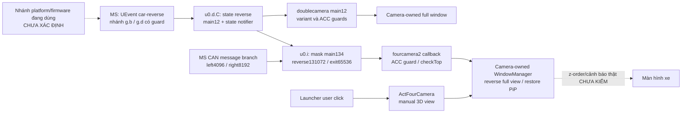

# Hợp đồng Wincavn đã đối chiếu tĩnh

15/10/2026 — phạm vi nghiên cứu từ `main/15dc34f`; **STATIC_VERIFIED**, chưa gọi IPC, chạy APK vendor hoặc quan sát xe. Tài liệu này là đặc tả bằng chứng liên APK, không phải SDK được phép gọi. Source TN vẫn chỉ mở 12 activity theo thao tác người dùng; increment sửa riêng navigation entry sang MainActivity bootstrap đã đối chiếu, không có toolkit/media/CAN/camera service adapter mới. Implementation và verification của từng chức năng nằm tại [parity matrix](../research/feature-parity-matrix.md).

## Nguồn và tái lập

Alias dưới đây trỏ đến đúng file, versionCode và SHA-256 đầy đủ tại [kiểm kê](../research/wincavn-resource-inventory.md#sha-256-nguyên-bản): L8=`com.android.launcher8/26031215`, MS=`com.syu.ms/2126091217`, FC=`com.syu.fourcamera2/2112291612`, DC=`com.syu.doublecamera/2112291612`, RC=`com.syu.rightcamera/2125122009`, CU=`com.syu.carui/2126092411`, MUSIC=`com.syu.music/2124092317`, BT=`com.syu.bt/2119010940`, RADIO=`com.syu.radio/25011809`, CARRADIO=`com.syu.carradio/2124091919`, EQ=`com.syu.eq/1`, NAV=`com.syu.onekeynavi/23071809`. Hash MS được sửa lỗi chép thiếu một ký tự; giá trị thực là `0494EA8CA3BE1B317A832C5E58761DA5E6A31EBCFAFD2662405E7ED1CD63043C`. Không thay APK gốc.

Mốc đường dẫn trong bảng là output tương đối dưới `%TEMP%/tn-launcher-analysis/`:

- `RemoteTools.java`, `CarStates.java`, `Launcher.java`, `MusicService.java`, `IRemoteToolkit.java`, `ToolkitService.java`, `ToolkitBinder.java`, `ModuleService.java`: output giữ lại của L8/MS. Launcher và Application được decompile lại từ hash khớp, nội dung tương đương sau chuẩn hóa newline.
- `root-contracts/`: JADX CLI xuất riêng Registrar, Callback, IRemoteModule, SyuJniNative, `ms-y.c.java`, `ms-y.b.java`, `ms-u0.i.java`, `ms-k0.wt.java`, `ms-y0.j.java`; `ms-extra/` có `base.b.java`, `com.syu.jni.ToolsJni.java`; `ms-inputs/` có `g.b.java`, `g.d.java`, `z.i.java`, `o1.i.java`, `e.h.java`.
- `camera-contracts-20261015/<launcher8|fourcamera2|doublecamera|rightcamera|carui>/`: filename đầy đủ là tên class Java, trừ output SIMPLE/smali được ghi riêng bên dưới.
- `stream-d/`: tiền tố `music-`, `bt-`, `radio-`, `carradio-`, `eq-`, `nav-`, `ms-`, `launcher-` phân biệt APK, ví dụ `music-App_MusicAction.java`, `ms-u0.d.java`. `nav-RemoteTools.java`/`nav-Registrar.java` được xuất từ chính NAV, không dùng bản L8 thay bằng chứng readiness của NAV.

Công cụ thực: Java21.0.8, JADX `dev` (`jadx.cli.JadxCLI` hoặc API cùng JAR), Apktool3.0.3, AAPT `v0.2-11948202`/Build Tools35.0.0. Ví dụ tái lập **phân tích tĩnh**, không phải gọi vendor:

```powershell
# $apk là nguyên bản đã đối chiếu SHA, $out là file TEMP ngoài repo.
& 'C:/Program Files/Java/jdk-21/bin/java.exe' -cp 'C:/Tools/jadx/lib/jadx-dev-all.jar' jadx.cli.JadxCLI -r --single-class com.syu.remote.Registrar --single-class-output $out $apk
```

Không dùng `java -jar` cho JAR này: Main-Class mở GUI, khác CLI wrapper. Các lượt GUI thuộc task đã dừng; không tính chúng là phân tích thành công. DEX cross-reference bằng dexlib2 đi kèm JADX xác nhận caller và offset, không thực thi APK. JADX AUTO có nhánh camera tái cấu trúc sai; đã đối chiếu SIMPLE/smali trước kết luận. Số dòng thuộc output của tool/version nêu trên, không phải source vendor nguyên bản.

Confidence: **HIGH** khi hai phía cùng signature/data flow; **MEDIUM** khi chỉ một phía có thêm metadata; **LOW/UNKNOWN** khi chỉ tên hoặc thiếu cạnh. Confidence tĩnh không chứng minh ordinary-app access, tương thích firmware hoặc an toàn xe.

## Toolkit, Binder và vòng đời

| Contract | Caller → receiver; dữ liệu và bằng chứng | Confidence / giới hạn |
| --- | --- | --- |
| IPC-01 Kết nối toolkit | L8 `CarStates:38–46` tạo/bind `com.syu.remote.RemoteTools`; constructor `(Context)` hoặc `(Context,String action,String pkg)`. `RemoteTools:28–67` dùng Application context, HandlerThread, action `com.syu.ms.toolkit`, package `com.syu.ms`, BIND_AUTO_CREATE. MS Manifest `ms-manifest.txt:98–102`, `app.ToolkitService.onBind`→`a.g.K2()` | HIGH cho endpoint. Manifest mẫu không có application/service caller permission hoặc exported override; filter khiến exported suy ra true ở API29. Không chứng minh firmware đang cài/SELinux cho phép. |
| IPC-02 Lấy module | Descriptor `com.syu.ipc.IRemoteToolkit`, transaction1 đồng bộ: `int moduleId`→Binder/null. L8 `IRemoteToolkit:38–48`; MS `MsToolkitInterface:46–75`, `ToolkitBinder:22–67` | HIGH. Module0→`u0.i`,1→`w0.i`,2→`h0.g`,4→`y0.j`,7→`k0.wt`; còn3/DVD,5/iPod,6/TV… `ModuleService` cũng map action `.main/.radio/.bt/.sound/.canbus` tới cùng factory, không phải contract riêng an toàn hơn. |
| IPC-03 Module operations | Descriptor `com.syu.ipc.IRemoteModule`: txn1 `cmd(int,int[],float[],String[])` void; txn2 `get(...)`→null hoặc ba mảng; txn3 `register(IModuleCallback,int updateCode,int update)`; txn4 `unregister(IModuleCallback,int updateCode)`. L8 `root-contracts/com.syu.ipc.IRemoteModule.java:12–16,47–94,115–194`; MS `ms-y.c.java` cùng wire layout | HIGH về wire layout; txn1/3/4 proxy dùng flag1/oneway, txn2 flag0. Proxy cũ còn đọc reply sau oneway: không sao chép implementation hay suy ra return/ack thành công từ đó. Không có version/capability negotiation thấy trong interface. |
| IPC-04 Callback | Descriptor `com.syu.ipc.IModuleCallback`, txn1/oneway: `update(int,int[],float[],String[])`; MS `ms-y.b.java:27–40,69–74`, L8 `IModuleCallback.Stub`/`Callback:13–30,66–99` | HIGH; tên đúng là IModuleCallback, không phải IRemoteCallback. Callback L8 post về main Looper và dispatch theo đúng code; null/malformed arrays vẫn phải được consumer kiểm tra. |
| IPC-05 Đăng ký/refresh | `Registrar:38–83,94–97` giữ callback/codes, `setModule` đăng ký, `notify` thực chất register lại với update=1. MS `u0.i.Y1:1571–1587` lưu subscriber và trả snapshot khi update!=0; `k0.wt.Y1:416–439` tương tự, có nhánh đặc thù | HIGH. Subscription tạo state phía service; một số CAN codes còn đổi cờ (`1019/1024`:514–540), nên không gọi mọi register là thao tác chỉ đọc vô hại. |
| IPC-06 Thread/error/reconnect | `RemoteTools:83–135,171–249`: lấy module trên worker, reconnect khi disconnect, `sendInt/Str/Flt`→`cmd`; thiếu registrar/module có thể bỏ lệnh im lặng. `Registrar:100–167` chỉ bắt RemoteException; get trước setModule còn có nguy cơ null. MS `ms-extra/base.b:65–92,129–141,181–187`: Binder cmd post sang HandlerThread rồi `N2` | HIGH. Không có typed success/error callback cho cmd. RemoteTools retry khoảng500–1999ms; bind cần thread có Looper; unBind không tự quit worker. Đây là rủi ro SDK cũ, không phải hành vi TN được thêm. |

`base.b.Y1/Z0:168–187` đọc calling PID để debug/log; không thấy UID/signature authorization check ở entry, factory, stub và các method dispatch đã đọc. `enforceInterface` xác nhận descriptor, không phải xác thực caller. **Không được ghi “signature-denied” cho toàn toolkit**, cũng không được ghi “app thường dùng được”. Chưa có runtime access, SELinux policy, toàn bộ module sâu hoặc version firmware. L8 remove một số listener tại `Launcher.onDestroy:4232–4235`; không chứng minh cleanup toàn bộ radio/RemoteTools. Một adapter tương lai phải có cancellation, unregister/death/reconnect/dedup riêng và không polling vô hạn.

## Camera: producer, consumer và chủ sở hữu hiển thị



Các mũi tên liền biểu thị đường code đã đối chiếu trong mẫu, không có nghĩa tất cả nhánh này cùng hoạt động trên xe. Trigger vật lý và mapping cấu hình vẫn cần bằng chứng riêng.

| Contract / parity | Bằng chứng | Kết luận và rủi ro |
| --- | --- | --- |
| CAM-TRIGGER / CAM-02 | MS `ms-inputs/g.b:174–219,253–254`, `g.d:277–295,507–508`: UEvent `GPIO_NAME=car-reverse GPIO_STATE=on/over`, guard platform/native boot-reverse và `sys.car.reverse`; `stream-d/ms-u0.d.C:398–422`→main12/notifier; `ms-u0.i:230–247,348–350,310–317,2434–2446`→mask main134 sau debounce100ms. CAN `ms-k0.wt.b3:717–725` đặt bit xi-nhan | HIGH cho từng đường Java; platform đang chọn và native/GPIO driver chưa xác định. Không thay thế bằng broadcast hoặc suy ra gear UI là camera trigger. |
| CAM-FULL / CAM-02,03 | FC `RegCode:11–34` đăng ký main134/ACC50, speed101, CAN; `FourCamera_Ipc:342–389`, `FourCamera_Ipc-2-simple:61–140,245–320`, smali callback `$2:3064,3277`; `App_FourCamera:2130–2157,2276–2373,3990–4070` | HIGH: reverse131072→index1→needTopType2→thoát PiP, full camera; exit có restore flag. Camera app gọi WindowManager.addView/type2008 (`App_FourCamera:404,700–738`), không phải Home tự giữ foreground. Không chứng minh thứ tự với cảnh báo/OEM khác hoặc hình camera thực. |
| CAM-PIP / CAM-03 | L8 `WindowUtil:54–80,93–191`→FC `Receiver_FourCamera2:20–47`: `FOURCAMERA2_BROADCAST_RECV`, KEY_TYPE10000, SHOW/POS_X/Y/W/H. FC producer `App_FourCamera:2022–2027` gửi `FOURCAMERA2_BROADCAST_SEND`; L8 branch `Launcher:6266–6286` | HIGH cho outbound layout consumer, MEDIUM cho inbound handshake: Launcher chỉ thấy đăng ký CLOSE_SYSTEM_DIALOGS tại1511–1513; không tìm thấy filter addAction camera/pipdie trong toàn class. Camera reverse gửi action có suffix `.fullscreen`, khác branch Launcher. Delivery inbound/receiver khác chưa nối được. PiP broadcast có thể hide/move/checkTop nên không phải capability probe. |
| CAM-VARIANT / CAM-02,03 | DC `RegCode:11–25`, `DoubleCamera_Ipc-2-simple:48–86`, `App_DoubleCamera:206,376–401,1129–1192,1807–1828`; RC `RegCode:11–22`, `RightCamera_Ipc_New:22–42`, `Page_Av:498–503` | DC nghe main12, guard iTruck/ACC và sở hữu window type2008. RC chỉ thấy forward reverse state; callback Page_Av start/end trống. Không tự fallback giữa các APK hoặc tuyên bố rightcamera tự takeover. |
| CAM-LIMO / CAM-02,03,V-06 | CU `ActivityIndex:1007–1016`: type1507776 `CAR_448_6606_ZX_Limo`, guard dual_mipi/Ls18/Lt18; `Activity6606_VF_Limo_CarUi:29–43,68–112,127–178,199–209`; Manifest XML156 | HIGH cho nhánh mẫu; chưa biết type/firmware thật. Activity Limo không filter/exported override→non-exported API29. CAN137 transition1→0 kết thúc; resume/pause gửi CAN, chọn channel13, cấu hình main36 và start/stopDisplay. Không thêm activity này làm fallback TN. |
| CAM-AR / NAV-02 | FC `ServiceCamera:20–60,114–136`, Manifest98–103: IGDCameraService AmapAR. `ServiceMain:10–23`, Manifest91–96 trả raw Binder | ServiceCamera trả literaltrue ở init/isConnected/isSupportArNavi; đăng ký callback còn shutdown/reinit, open/close thay camera. Không dùng returntrue làm kiểm chứng thiết bị. ServiceMain không tự cung cấp typed control API từ tên action. |

FC `com.syu.jni.NativeLibrary:194` load `Native`; L8 `root-contracts/com.syu.jni.SyuJniNative:44–63` load `syu_jni` và native `syu_jni_command(int,Object,Object)`. ZIP directory của cả34APK không có `libsyu_jni.so`; MS chỉ có `libsyu_uinput.so` ở bốn ABI. FC không có lib entries. Thư viện runtime có thể nằm ngoài APK; không xác định file/version/system path từ tên. Đây là dependency thiếu, không phải lý do chạy IDA trên một binary khác hoặc gọi JNI thử.

## CAN, tốc độ, ACC và display

| Contract / parity | Data flow đã đọc | Giới hạn / phân loại |
| --- | --- | --- |
| CAR-STATE / V-06 | L8 `CarStates:20–26,50–91`: module0 app0/ACC50, module7 canType1000/OEM radio1016. `Launcher:732–741,1231–1335` nhận module7/update1049 `ints[0]=flag,ints[1]=value`; `FinalCanbus.U_6606_CARINF=1049` | HIGH consumer, chưa đóng được producer đúng active vehicle variant. 1049 xuất hiện trong nhiều parser MS; không phải schema chung cho mọi CAN type. Không live subscribe. |
| CAR-FIELDS / V-06 | Consumer L8 flag1 speed text,3 park indicator(value0 selected),4 gear,5 range text,10 seatbelt,11 bit7/6/5/4/3 lights,12 brake,20 mileage,24 power/percent,26 mode,27 tire indicator,28 Ready. `Launcher.setGear:2192–2212`:1D/2N/3R/4P | MEDIUM về ý nghĩa consumer, chưa có unit/freshness/validity và producer đúng version. Không hiển thị các giá trị này như dữ liệu xe khi chỉ biết tên/flag. Raw0/default không tự nghĩa là trạng thái thật an toàn. |
| CAR-SPEED / V-06 | MS `ms-inputs/o1.i.onLocationChanged:330–348`: GPSgetSpeed×3.6 khi F1; `ms-k0.wt.b3:727–730`: CAN-derived fallback chia10 khi !F1; `stream-d/ms-u0.d.v0:4143–4147`→main101. FC callback CAN7/1031 ưu tiên hơn main101 (`FourCamera_Ipc:446–454,648–663`) | HIGH cho nguồn lựa chọn, chưa biết firmware flag/units của từng vehicle packet. Main101 không được gọi thuần là CANspeed; guidance CUR_SPEED là nguồn map thứ ba. L8 refreshMain có case101 nhưng đăng ký listener chỉ0/50/4 (`Launcher:1540`), nên không chứng minh branch101 được UI này nhận. |
| CAR-ACC / BOOT-01 | MS MCUparser `ms-inputs/z.i.j:1678–1689` đọc nhánh byte49/50→`u0.d.i:3126–3155` cập nhật ACC/main50, notifier và các tác động sleep/audio/display. L8 CarStates/main50 và camera consumer ACC guards | HIGH cho Java branch; chưa biết protocol/board đang dùng, ACC timing/sleep/wake thật. TN không gửi command mô phỏng ACC hoặc tự restart Home. |
| DISPLAY-CONTROL / DISPLAY-01 | L8 `Launcher:4955–4959,5013` dùng module0/cmd10[-3],cmd16[1], PopWindowBright; constants `FinalMain.C_BRIGHT_LEVEL/C_BLACKSCREEN`; MS `ms-u0.i.N2:577–589,607–610`→`u0.d.Q/N` | HIGH cho command dispatch, chưa có panel mapping/native implementation phù hợp. Đây là write/control, không tương đương window-local brightness Android; không gửi lệnh tắt màn hoặc thay WRITE_SETTINGS permission để tuyên bố parity. |

Không có CAN/MCU packet được phát, property nào được ghi hay fixture chứa dữ liệu xe thật. Việc tìm331 literal1049 trong DEX là chỉ dẫn xref; chỉ các method đã đọc mới là bằng chứng semantics. Full binary firmware/native và active platform/CAN type vẫn thiếu.

## Media, radio, DSP và điều hướng

| Contract / parity | Caller → consumer / schema | Confidence, khả thi và điểm thiếu |
| --- | --- | --- |
| MEDIA-MUSIC-IN / V-05 | MUSIC `App:123–125`→`App_MusicAction.updateLauncher:23–60,105–113`: action `com.fyt.launcher.music` gửi startService tới package của default HOME được resolve. Keys `play_state` boolean; `title`, `play_artist`, `play_album`, `play_path` String; `play_cur/play_total` long ms. L8 `MusicService:42–70` consumer; MUSIC `App_Music:664–668` lấy PlayerCore positions | HIGH tĩnh, chứng minh không hardcode identity launcher8 ở đường gửi này. Mỗi payload là snapshot. Toolkit cmd23 đường khác chia1000 (`music-Ipc_New:516–517`), không trộn đơn vị. Chưa có xác thực sender/freshness/background-start compatibility; không thêm exported service vào TN chỉ vì thấy schema. Không lưu title/path thật vào graph/log. |
| MEDIA-BT-IN / V-05,V-13 | BT `Ipc_New:475–500,1729–1743,1766–1774` gửi `com.syu.widget.BtavService` tới default HOME; String `btav`, `btav_art`, `btav_curtime`, `btav_totaltime` là **partial patches**. L8 `launcher-BtavService:22–40` giữ giá trị cũ khi thiếu | HIGH. Không có playback boolean như MUSIC; variant TZY_NEW không gửi time, có placeholder ở variant khác. Parser cần kiểm soát số/null/độ dài/stale/nguồn, không copy lỗi NumberFormatException của consumer cũ. |
| MEDIA-TRANSPORT / V-05 | L8 `Launcher:3341–3405,3444–3484` gửi service actions `.prev/.next/.playpause` MUSIC/BT; `3515–3543` video dùng main20. MUSIC `MService` và BT service xử lý trong app gốc; MS main20→`u0.g.b` | Có caller/receiver, nhưng service side effects, target SDK/background limits, audio-source selection và firmware chưa được chứng minh tương thích. Không biến action tìm thấy thành API stable hoặc dùng startService thử. |
| MEDIA-SESSION / V-05 | MUSIC `MediaManager:49–69,82–137`, `MyTask:50–57`; BT `MediaManager:54–72,87–154`, `App_Bt:119,1170–1227`, `Ipc_New:321–326` | HIGH: có Android MediaSession metadata/playback. MUSIC phụ thuộc current audio app, BT còn cờ media_manager (mặc định false) và audio ID. Chỉ override media-button callback; BT key126/127 cùng toggle, không play/pause idempotent; PlaybackState mới có thể mất actions, MUSIC position0. Không suy ra transport/seek chung đáng tin. |
| RADIO-STATE / RADIO-01 | RADIO `Ipc:319–324,476–482`, `RadioM:135–165`: band/freq DATA0/1, module1 observe; L8 `Launcher:3297–3338`; MS `stream-d/ms-w0.i:34–65` xử lý prev/next | HIGH cho module1 caller/receiver; hardware tuner/band/step/OEM source thật chưa kiểm. Carradio `ActivityLauncher:33–74,86–112` chọn theo CANtype và chờ connect không timeout; không thay radio bằng carradio tự động. |
| AUDIO-DSP / AUDIO-01 | L8 `Launcher:3292,4967–4971,5027–5029`: main0 source, sound4/cmd0 volume. MS `ms-y0.j:204–249`→sound helpers; EQ `MyActivity:111–121,163–175` observe/command module4 | HIGH dispatch, chip/routing/native/quyền runtime vẫn thiếu. EQ có JDSP/AudioEffect reflective code nhưng `MyService` **không khai báo trong Manifest**; không báo Binder đó callable/active. Mẫu EQ unsigned. AudioManager chỉ quản lý Android streams không chứng minh toàn bộ audio source OEM. |
| NAV-REQUEST / NAV-UI,NAV-01 | NAV `MainActivity:13–16` đặt launch=true/notify0/28; `stream-d/nav-OneKeyNavi:19–31` chờ callback28 rồi mở `LaunchNavi:17–26`→main0/cmd24[0]. MS `ms-u0.i:653–656`→`stream-d/ms-u0.d.N0:1394–1404`→`ms-o1.u.t0/u0/v0:1026–1065`, default package `u0.b.M1`. Setter `u0.d.k2:3330–3348` persist130/property/callback28; `ms-ReceiverApp:20–26` clear khi package removed | HIGH về bootstrap/backend. Direct LaunchNavi gửi ngay trong onCreate; NAV `nav-RemoteTools:78–99,168–178`/`nav-Registrar:85–92` còn có thể chưa có module rồi silently drop; LaunchNavi:29–34 thoát process. **Cold-start race là inference tĩnh**, chưa chạy vendor để đo. TN đổi sang explicit public MainActivity/ACTION_MAIN, không arbitrary package fallback; chờ do app vendor quản lý. Empty/default missing có callback45, null intent/error còn return2/swallow; không chứng minh chooser/fallback/map thật. TN không set default map qua toolkit. |
| NAV-GUIDANCE / NAV-02 | L8 `launcher-MyAutoMapReceiver:34–99`: KEY_TYPE10001/10019, top package bằng package Launcher gốc ghép từ resource + ACC + `apps_widget_navi`; skin `launcher8-resources/res/values/bools.xml:42` false | MEDIUM: consumer schema có, map producer APK/version/quyền sender chưa xác minh. Guard không resolve Home hiện tại. Guidance widget dormant theo flag mẫu; CUR_SPEED từ bundle map, không CAN. Không thêm receiver spoofable hoặc giả hướng dẫn. Camera AR và WindowUtil PiP là các contract khác. |

Theo [MediaSessionManager.getActiveSessions](https://developer.android.com/reference/android/media/session/MediaSessionManager#getActiveSessions(android.content.ComponentName)), app cần MEDIA_CONTENT_CONTROL hoặc notification listener đã được người dùng bật. TN hiện không có cả hai; không tự thêm quyền rộng hoặc yêu cầu special access để biến discovery thành tính năng trong lượt này. [Giới hạn background service](https://developer.android.com/about/versions/oreo/background#services) cũng cần được đánh giá cho giao thức startService legacy; một sender UID hệ thống không tự chứng minh service đích thường tương thích ở mọi lifecycle.

## Quyết định triển khai và bằng chứng còn cần

- **A — triển khai:** sửa riêng `navigation` sang explicit public MainActivity/ACTION_MAIN để dùng bootstrap gốc đã nối callback. Không thay bằng package launcher bất kỳ; vẫn kiểm tra enabled/exported/permission và chỉ mở khi người dùng bấm. Regression fixture kiểm tra explicit component/action và ca lỗi; gate API29/ artifact xem compatibility report. Đây là sửa đường request, chưa là vendor runtime verification. Không thêm numeric-command adapter, receiver/service hoặc UI điều khiển chưa hoạt động.
- **B — fixture cô lập:** schema MUSIC snapshot/BT patch, validation null/oversize/số sai/nguồn thay đổi, callback lifecycle và MediaSession action handling là phạm vi khả thi cho một feature được scope sau. Chưa thêm parser production không có consumer chỉ để tăng số test; chưa tuyên bố các fixture này đã chạy.
- **C — static tiếp:** đọc đúng native dependency/platform factory và parser CAN active; resolve receiver `.fullscreen`/inbound registration gap; đối chiếu map producer và media service caller policy/background behavior với contract version. Cần artifact cụ thể hoặc cấu hình không nhạy cảm có liên quan, không đọc hàng loạt log/backup hoặc tải lại archive.
- **D — chỉ phiên thiết bị được cho phép riêng:** ordinary-app toolkit access (không gọi write), camera variant/routing/hình thật, reverse/warning precedence, return Home, radio/DSP/audio routing, default map/ACC/sleep/wake. Trước mọi cài/chọn Home vẫn phải có emulator gate cho đúng APK và rollback đã xác minh. Không có đề nghị hoặc hành động thiết bị trong lượt nghiên cứu này.

**Full reconstruction INCOMPLETE; Figma deferred.** Mức mới là contract evidence chính xác hơn; không có DEVICE_VERIFIED/AUTOMOTIVE_VERIFIED và không nâng mức hardware từ graph, shortcut hoặc static confidence.
