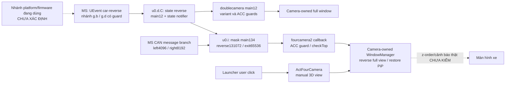

# Hợp đồng Wincavn đã đối chiếu tĩnh

16/10/2026 — increment nghiên cứu tĩnh W1–W8 trên `main/6a02097a0d0186a2e2ace70e4ba8c1287176af87`, worktree sạch ở preflight. **STATIC_VERIFIED**; không sửa source/Gradle/Manifest, chạy APK vendor, ADB, IPC, thiết bị, Figma hoặc commit/push. Các mục trước W1 bên dưới giữ provenance nghiên cứu từ15dc34f đã bàn giao trong6a02097; navigation bootstrap là source hiện có, không phải implementation mới của lượt này. [Parity matrix](../research/feature-parity-matrix.md) giữ trạng thái implementation/verification độc lập.

## Nguồn và tái lập

Alias dưới đây trỏ đến đúng file, versionCode và SHA-256 đầy đủ tại [kiểm kê](../research/wincavn-resource-inventory.md#sha-256-nguyên-bản): L8=`com.android.launcher8/26031215`, MS=`com.syu.ms/2126091217`, FC=`com.syu.fourcamera2/2112291612`, DC=`com.syu.doublecamera/2112291612`, RC=`com.syu.rightcamera/2125122009`, CU=`com.syu.carui/2126092411`, MUSIC=`com.syu.music/2124092317`, BT=`com.syu.bt/2119010940`, RADIO=`com.syu.radio/25011809`, CARRADIO=`com.syu.carradio/2124091919`, EQ=`com.syu.eq/1`, NAV=`com.syu.onekeynavi/23071809`. Hash MS được sửa lỗi chép thiếu một ký tự; giá trị thực là `0494EA8CA3BE1B317A832C5E58761DA5E6A31EBCFAFD2662405E7ED1CD63043C`. Không thay APK gốc.

Mốc đường dẫn trong bảng là output tương đối dưới `%TEMP%/tn-launcher-analysis/`:

- `RemoteTools.java`, `CarStates.java`, `Launcher.java`, `MusicService.java`, `IRemoteToolkit.java`, `ToolkitService.java`, `ToolkitBinder.java`, `ModuleService.java`: output giữ lại của L8/MS. Launcher và Application được decompile lại từ hash khớp, nội dung tương đương sau chuẩn hóa newline.
- `root-contracts/`: JADX CLI xuất riêng Registrar, Callback, IRemoteModule, SyuJniNative, `ms-y.c.java`, `ms-y.b.java`, `ms-u0.i.java`, `ms-k0.wt.java`, `ms-y0.j.java`; `ms-extra/` có `base.b.java`, `com.syu.jni.ToolsJni.java`; `ms-inputs/` có `g.b.java`, `g.d.java`, `z.i.java`, `o1.i.java`, `e.h.java`.
- `camera-contracts-20261015/<launcher8|fourcamera2|doublecamera|rightcamera|carui>/`: filename đầy đủ là tên class Java, trừ output SIMPLE/smali được ghi riêng bên dưới.
- `stream-d/`: tiền tố `music-`, `bt-`, `radio-`, `carradio-`, `eq-`, `nav-`, `ms-`, `launcher-` phân biệt APK, ví dụ `music-App_MusicAction.java`, `ms-u0.d.java`. `nav-RemoteTools.java`/`nav-Registrar.java` được xuất từ chính NAV, không dùng bản L8 thay bằng chứng readiness của NAV.

Công cụ thực: Java21.0.8, JADX `dev` (`jadx.cli.JadxCLI` hoặc API cùng JAR), Apktool3.0.3, AAPT `v0.2-11948202`/Build Tools35.0.0. Ví dụ tái lập **phân tích tĩnh**, không phải gọi vendor:

```powershell
# $apk là nguyên bản đã đối chiếu SHA, $out là file TEMP ngoài repo.
& 'C:/Program Files/Java/jdk-21/bin/java.exe' -cp 'C:/Tools/jadx/lib/jadx-dev-all.jar' jadx.cli.JadxCLI -r --single-class com.syu.remote.Registrar --single-class-output $out $apk
```

Không dùng `java -jar` cho JAR này: Main-Class mở GUI, khác CLI wrapper. Các lượt GUI thuộc task đã dừng; không tính chúng là phân tích thành công. DEX cross-reference bằng dexlib2 đi kèm JADX xác nhận caller và offset, không thực thi APK. JADX AUTO có nhánh camera tái cấu trúc sai; đã đối chiếu SIMPLE/smali trước kết luận. Số dòng thuộc output của tool/version nêu trên, không phải source vendor nguyên bản.

Confidence: **HIGH** khi hai phía cùng signature/data flow; **MEDIUM** khi chỉ một phía có thêm metadata; **LOW/UNKNOWN** khi chỉ tên hoặc thiếu cạnh. Confidence tĩnh không chứng minh ordinary-app access, tương thích firmware hoặc an toàn xe.

## Toolkit, Binder và vòng đời

| Contract | Caller → receiver; dữ liệu và bằng chứng | Confidence / giới hạn |
| --- | --- | --- |
| IPC-01 Kết nối toolkit | L8 `CarStates:38–46` tạo/bind `com.syu.remote.RemoteTools`; constructor `(Context)` hoặc `(Context,String action,String pkg)`. `RemoteTools:28–67` dùng Application context, HandlerThread, action `com.syu.ms.toolkit`, package `com.syu.ms`, BIND_AUTO_CREATE. MS Manifest `ms-manifest.txt:98–102`, `app.ToolkitService.onBind`→`a.g.K2()` | HIGH cho endpoint. Manifest mẫu không có application/service caller permission hoặc exported override; filter khiến exported suy ra true ở API29. Không chứng minh firmware đang cài/SELinux cho phép. |
| IPC-02 Lấy module | Descriptor `com.syu.ipc.IRemoteToolkit`, transaction1 đồng bộ: `int moduleId`→Binder/null. L8 `IRemoteToolkit:38–48`; MS `MsToolkitInterface:46–75`, `ToolkitBinder:22–67` | HIGH. Module0→`u0.i`,1→`w0.i`,2→`h0.g`,4→`y0.j`,7→`k0.wt`; còn3/DVD,5/iPod,6/TV… `ModuleService` cũng map action `.main/.radio/.bt/.sound/.canbus` tới cùng factory, không phải contract riêng an toàn hơn. |
| IPC-03 Module operations | Descriptor `com.syu.ipc.IRemoteModule`: txn1 `cmd(int,int[],float[],String[])` void; txn2 `get(...)`→null hoặc ba mảng; txn3 `register(IModuleCallback,int updateCode,int update)`; txn4 `unregister(IModuleCallback,int updateCode)`. L8 `root-contracts/com.syu.ipc.IRemoteModule.java:12–16,47–94,115–194`; MS `ms-y.c.java` cùng wire layout | HIGH về wire layout; txn1/3/4 proxy dùng flag1/oneway, txn2 flag0. Proxy cũ còn đọc reply sau oneway: không sao chép implementation hay suy ra return/ack thành công từ đó. Không có version/capability negotiation thấy trong interface. |
| IPC-04 Callback | Descriptor `com.syu.ipc.IModuleCallback`, txn1/oneway: `update(int,int[],float[],String[])`; MS `ms-y.b.java:27–40,69–74`, L8 `IModuleCallback.Stub`/`Callback:13–30,66–99` | HIGH; tên đúng là IModuleCallback, không phải IRemoteCallback. Callback L8 post về main Looper và dispatch theo đúng code; null/malformed arrays vẫn phải được consumer kiểm tra. |
| IPC-05 Đăng ký/refresh | `Registrar:38–83,94–97` giữ callback/codes, `setModule` đăng ký, `notify` thực chất register lại với update=1. MS `u0.i.Y1:1571–1587` lưu subscriber và trả snapshot khi update!=0; `k0.wt.Y1:416–439` tương tự, có nhánh đặc thù | HIGH. Subscription tạo state phía service; một số CAN codes còn đổi cờ (`1019/1024`:514–540), nên không gọi mọi register là thao tác chỉ đọc vô hại. |
| IPC-06 Thread/error/reconnect | `RemoteTools:83–135,171–249`: lấy module trên worker, reconnect khi disconnect, `sendInt/Str/Flt`→`cmd`; thiếu registrar/module có thể bỏ lệnh im lặng. `Registrar:100–167` chỉ bắt RemoteException; get trước setModule còn có nguy cơ null. MS `ms-extra/base.b:65–92,129–141,181–187`: Binder cmd post sang HandlerThread rồi `N2` | HIGH. Không có typed success/error callback cho cmd. RemoteTools retry khoảng500–1999ms; bind cần thread có Looper; unBind không tự quit worker. Đây là rủi ro SDK cũ, không phải hành vi TN được thêm. |

`base.b.Y1/Z0:168–187` đọc calling PID để debug/log; không thấy UID/signature authorization check ở entry, factory, stub và các method dispatch đã đọc. `enforceInterface` xác nhận descriptor, không phải xác thực caller. **Không được ghi “signature-denied” cho toàn toolkit**, cũng không được ghi “app thường dùng được”. Chưa có runtime access, SELinux policy, toàn bộ module sâu hoặc version firmware. L8 remove một số listener tại `Launcher.onDestroy:4232–4235`; không chứng minh cleanup toàn bộ radio/RemoteTools. Một adapter tương lai phải có cancellation, unregister/death/reconnect/dedup riêng và không polling vô hạn.

## Camera: producer, consumer và chủ sở hữu hiển thị



Các mũi tên liền biểu thị đường code đã đối chiếu trong mẫu, không có nghĩa tất cả nhánh này cùng hoạt động trên xe. Trigger vật lý và mapping cấu hình vẫn cần bằng chứng riêng.

| Contract / parity | Bằng chứng | Kết luận và rủi ro |
| --- | --- | --- |
| CAM-TRIGGER / CAM-02 | MS `ms-inputs/g.b:174–219,253–254`, `g.d:277–295,507–508`: UEvent `GPIO_NAME=car-reverse GPIO_STATE=on/over`, guard platform/native boot-reverse và `sys.car.reverse`; `stream-d/ms-u0.d.C:398–422`→main12/notifier; `ms-u0.i:230–247,348–350,310–317,2434–2446`→mask main134 sau debounce100ms. CAN `ms-k0.wt.b3:717–725` đặt bit xi-nhan | HIGH cho từng đường Java; platform đang chọn và native/GPIO driver chưa xác định. Không thay thế bằng broadcast hoặc suy ra gear UI là camera trigger. |
| CAM-FULL / CAM-02,03 | FC `RegCode:11–34` đăng ký main134/ACC50, speed101, CAN; `FourCamera_Ipc:342–389`, `FourCamera_Ipc-2-simple:61–140,245–320`, smali callback `$2:3064,3277`; `App_FourCamera:2130–2157,2276–2373,3990–4070` | HIGH: reverse131072→index1→needTopType2→thoát PiP, full camera; exit có restore flag. Camera app gọi WindowManager.addView/type2008 (`App_FourCamera:404,700–738`), không phải Home tự giữ foreground. Không chứng minh thứ tự với cảnh báo/OEM khác hoặc hình camera thực. |
| CAM-PIP / CAM-03 | L8 `WindowUtil:54–80,93–191`→FC `Receiver_FourCamera2:20–47`: `FOURCAMERA2_BROADCAST_RECV`, KEY_TYPE10000, SHOW/POS_X/Y/W/H. FC producer `App_FourCamera:2022–2027` gửi `FOURCAMERA2_BROADCAST_SEND`; L8 branch `Launcher:6266–6286` | HIGH cho outbound layout consumer, MEDIUM cho inbound handshake: Launcher chỉ thấy đăng ký CLOSE_SYSTEM_DIALOGS tại1511–1513; không tìm thấy filter addAction camera/pipdie trong toàn class. Camera reverse gửi action có suffix `.fullscreen`, khác branch Launcher. Delivery inbound/receiver khác chưa nối được. PiP broadcast có thể hide/move/checkTop nên không phải capability probe. |
| CAM-VARIANT / CAM-02,03 | DC `RegCode:11–25`, `DoubleCamera_Ipc-2-simple:48–86`, `App_DoubleCamera:206,376–401,1129–1192,1807–1828`; RC `RegCode:11–22`, `RightCamera_Ipc_New:22–42`, `Page_Av:498–503` | DC nghe main12, guard iTruck/ACC và sở hữu window type2008. RC chỉ thấy forward reverse state; callback Page_Av start/end trống. Không tự fallback giữa các APK hoặc tuyên bố rightcamera tự takeover. |
| CAM-LIMO / CAM-02,03,V-06 | CU `ActivityIndex:1007–1016`: type1507776 `CAR_448_6606_ZX_Limo`, guard dual_mipi/Ls18/Lt18; `Activity6606_VF_Limo_CarUi:29–43,68–112,127–178,199–209`; Manifest XML156 | HIGH cho nhánh mẫu; chưa biết type/firmware thật. Activity Limo không filter/exported override→non-exported API29. CAN137 transition1→0 kết thúc; resume/pause gửi CAN, chọn channel13, cấu hình main36 và start/stopDisplay. Không thêm activity này làm fallback TN. |
| CAM-AR / NAV-02 | FC `ServiceCamera:20–60,114–136`, Manifest98–103: IGDCameraService AmapAR. `ServiceMain:10–23`, Manifest91–96 trả raw Binder | ServiceCamera trả literaltrue ở init/isConnected/isSupportArNavi; đăng ký callback còn shutdown/reinit, open/close thay camera. Không dùng returntrue làm kiểm chứng thiết bị. ServiceMain không tự cung cấp typed control API từ tên action. |

FC `com.syu.jni.NativeLibrary:194` load `Native`; L8 `root-contracts/com.syu.jni.SyuJniNative:44–63` load `syu_jni` và native `syu_jni_command(int,Object,Object)`. ZIP directory của cả34APK không có `libsyu_jni.so`; MS chỉ có `libsyu_uinput.so` ở bốn ABI. FC không có lib entries. Thư viện runtime có thể nằm ngoài APK; không xác định file/version/system path từ tên. Đây là dependency thiếu, không phải lý do chạy IDA trên một binary khác hoặc gọi JNI thử.

## CAN, tốc độ, ACC và display

| Contract / parity | Data flow đã đọc | Giới hạn / phân loại |
| --- | --- | --- |
| CAR-STATE / V-06 | L8 `CarStates:20–26,50–91`: module0 app0/ACC50, module7 canType1000/OEM radio1016. `Launcher:732–741,1231–1335` nhận module7/update1049 `ints[0]=flag,ints[1]=value`; `FinalCanbus.U_6606_CARINF=1049` | HIGH cho consumer và producer MS jl có điều kiện được nối trong W2; active vehicle variant vẫn chưa xác minh.1049 không là schema chung cho mọi CAN type. Không live subscribe. |
| CAR-FIELDS / V-06 | Consumer L8 flag1 speed text,3 park indicator(value0 selected),4 gear,5 range text,10 seatbelt,11 bit7/6/5/4/3 lights,12 brake,20 mileage,24 power/percent,26 mode,27 tire indicator,28 Ready. `Launcher.setGear:2192–2212`:1D/2N/3R/4P | MEDIUM về ý nghĩa consumer, chưa có unit/freshness/validity và producer đúng version. Không hiển thị các giá trị này như dữ liệu xe khi chỉ biết tên/flag. Raw0/default không tự nghĩa là trạng thái thật an toàn. |
| CAR-SPEED / V-06 | MS `ms-inputs/o1.i.onLocationChanged:330–348`: GPSgetSpeed×3.6 khi F1; `ms-k0.wt.b3:727–730`: CAN-derived fallback chia10 khi !F1; `stream-d/ms-u0.d.v0:4143–4147`→main101. FC callback CAN7/1031 ưu tiên hơn main101 (`FourCamera_Ipc:446–454,648–663`) | HIGH cho nguồn lựa chọn, chưa biết firmware flag/units của từng vehicle packet. Main101 không được gọi thuần là CANspeed; guidance CUR_SPEED là nguồn map thứ ba. L8 refreshMain có case101 nhưng đăng ký listener chỉ0/50/4 (`Launcher:1540`), nên không chứng minh branch101 được UI này nhận. |
| CAR-ACC / BOOT-01 | MS MCUparser `ms-inputs/z.i.j:1678–1689` đọc nhánh byte49/50→`u0.d.i:3126–3155` cập nhật ACC/main50, notifier và các tác động sleep/audio/display. L8 CarStates/main50 và camera consumer ACC guards | HIGH cho Java branch; chưa biết protocol/board đang dùng, ACC timing/sleep/wake thật. TN không gửi command mô phỏng ACC hoặc tự restart Home. |
| DISPLAY-CONTROL / DISPLAY-01 | L8 `Launcher:4955–4959,5013` dùng module0/cmd10[-3],cmd16[1], PopWindowBright; constants `FinalMain.C_BRIGHT_LEVEL/C_BLACKSCREEN`; MS `ms-u0.i.N2:577–589,607–610`→`u0.d.Q/N` | HIGH cho command dispatch, chưa có panel mapping/native implementation phù hợp. Đây là write/control, không tương đương window-local brightness Android; không gửi lệnh tắt màn hoặc thay WRITE_SETTINGS permission để tuyên bố parity. |

Không có CAN/MCU packet được phát, property nào được ghi hay fixture chứa dữ liệu xe thật. Việc tìm331 literal1049 trong DEX là chỉ dẫn xref; chỉ các method đã đọc mới là bằng chứng semantics. Full binary firmware/native và active platform/CAN type vẫn thiếu.

## Media, radio, DSP và điều hướng

| Contract / parity | Caller → consumer / schema | Confidence, khả thi và điểm thiếu |
| --- | --- | --- |
| MEDIA-MUSIC-IN / V-05 | MUSIC `App:123–125`→`App_MusicAction.updateLauncher:23–60,105–113`: action `com.fyt.launcher.music` gửi startService tới package của default HOME được resolve. Keys `play_state` boolean; `title`, `play_artist`, `play_album`, `play_path` String; `play_cur/play_total` long ms. L8 `MusicService:42–70` consumer; MUSIC `App_Music:664–668` lấy PlayerCore positions | HIGH tĩnh, chứng minh không hardcode identity launcher8 ở đường gửi này. Mỗi payload là snapshot. Toolkit cmd23 đường khác chia1000 (`music-Ipc_New:516–517`), không trộn đơn vị. Chưa có xác thực sender/freshness/background-start compatibility; không thêm exported service vào TN chỉ vì thấy schema. Không lưu title/path thật vào graph/log. |
| MEDIA-BT-IN / V-05,V-13 | BT `Ipc_New:475–500,1729–1743,1766–1774` gửi `com.syu.widget.BtavService` tới default HOME; String `btav`, `btav_art`, `btav_curtime`, `btav_totaltime` là **partial patches**. L8 `launcher-BtavService:22–40` giữ giá trị cũ khi thiếu | HIGH. Không có playback boolean như MUSIC; variant TZY_NEW không gửi time, có placeholder ở variant khác. Parser cần kiểm soát số/null/độ dài/stale/nguồn, không copy lỗi NumberFormatException của consumer cũ. |
| MEDIA-TRANSPORT / V-05 | L8 `Launcher:3341–3405,3444–3484` gửi service actions `.prev/.next/.playpause` MUSIC/BT; `3515–3543` video dùng main20. MUSIC `MService` và BT service xử lý trong app gốc; MS main20→`u0.g.b` | Có caller/receiver, nhưng service side effects, target SDK/background limits, audio-source selection và firmware chưa được chứng minh tương thích. Không biến action tìm thấy thành API stable hoặc dùng startService thử. |
| MEDIA-SESSION / V-05 | MUSIC `MediaManager:49–69,82–137`, `MyTask:50–57`; BT `MediaManager:54–72,87–154`, `App_Bt:119,1170–1227`, `Ipc_New:321–326` | HIGH: có Android MediaSession metadata/playback. MUSIC phụ thuộc current audio app, BT còn cờ media_manager (mặc định false) và audio ID. Chỉ override media-button callback; BT key126/127 cùng toggle, không play/pause idempotent; PlaybackState mới có thể mất actions, MUSIC position0. Không suy ra transport/seek chung đáng tin. |
| RADIO-STATE / RADIO-01 | RADIO `Ipc:319–324,476–482`, `RadioM:135–165`: band/freq DATA0/1, module1 observe; L8 `Launcher:3297–3338`; MS `stream-d/ms-w0.i:34–65` xử lý prev/next | HIGH cho module1 caller/receiver; hardware tuner/band/step/OEM source thật chưa kiểm. Carradio `ActivityLauncher:33–74,86–112` chọn theo CANtype và chờ connect không timeout; không thay radio bằng carradio tự động. |
| AUDIO-DSP / AUDIO-01 | L8 `Launcher:3292,4967–4971,5027–5029`: main0 source, sound4/cmd0 volume. MS `ms-y0.j:204–249`→sound helpers; EQ `MyActivity:111–121,163–175` observe/command module4 | HIGH dispatch, chip/routing/native/quyền runtime vẫn thiếu. EQ có JDSP/AudioEffect reflective code nhưng `MyService` **không khai báo trong Manifest**; không báo Binder đó callable/active. Mẫu EQ unsigned. AudioManager chỉ quản lý Android streams không chứng minh toàn bộ audio source OEM. |
| NAV-REQUEST / NAV-UI,NAV-01 | NAV `MainActivity:13–16` đặt launch=true/notify0/28; `stream-d/nav-OneKeyNavi:19–31` chờ callback28 rồi mở `LaunchNavi:17–26`→main0/cmd24[0]. MS `ms-u0.i:653–656`→`stream-d/ms-u0.d.N0:1394–1404`→`ms-o1.u.t0/u0/v0:1026–1065`, default package `u0.b.M1`. Setter `u0.d.k2:3330–3348` persist130/property/callback28; `ms-ReceiverApp:20–26` clear khi package removed | HIGH về bootstrap/backend. Direct LaunchNavi gửi ngay trong onCreate; NAV `nav-RemoteTools:78–99,168–178`/`nav-Registrar:85–92` còn có thể chưa có module rồi silently drop; LaunchNavi:29–34 thoát process. **Cold-start race là inference tĩnh**, chưa chạy vendor để đo. TN đổi sang explicit public MainActivity/ACTION_MAIN, không arbitrary package fallback; chờ do app vendor quản lý. Empty/default missing có callback45, null intent/error còn return2/swallow; không chứng minh chooser/fallback/map thật. TN không set default map qua toolkit. |
| NAV-GUIDANCE / NAV-02 | L8 `launcher-MyAutoMapReceiver:34–99`: KEY_TYPE10001/10019, top package bằng `com.android.launcher7` (resource thực7 ngay cả L8) + ACC + `apps_widget_navi`; skin `launcher8-resources/res/values/bools.xml:42` false | MEDIUM: consumer schema có, map producer APK/version/quyền sender chưa xác minh. Guard không resolve Home hiện tại. Guidance widget dormant theo flag mẫu; CUR_SPEED từ bundle map, không CAN. Không thêm receiver spoofable hoặc giả hướng dẫn. Camera AR và WindowUtil PiP là các contract khác. |

Theo [MediaSessionManager.getActiveSessions](https://developer.android.com/reference/android/media/session/MediaSessionManager#getActiveSessions(android.content.ComponentName)), app cần MEDIA_CONTENT_CONTROL hoặc notification listener đã được người dùng bật. TN hiện không có cả hai; không tự thêm quyền rộng hoặc yêu cầu special access để biến discovery thành tính năng trong lượt này. [Giới hạn background service](https://developer.android.com/about/versions/oreo/background#services) cũng cần được đánh giá cho giao thức startService legacy; một sender UID hệ thống không tự chứng minh service đích thường tương thích ở mọi lifecycle.

## Quyết định triển khai và bằng chứng còn cần

- **A — triển khai:** sửa riêng `navigation` sang explicit public MainActivity/ACTION_MAIN để dùng bootstrap gốc đã nối callback. Không thay bằng package launcher bất kỳ; vẫn kiểm tra enabled/exported/permission và chỉ mở khi người dùng bấm. Regression fixture kiểm tra explicit component/action và ca lỗi; gate API29/ artifact xem compatibility report. Đây là sửa đường request, chưa là vendor runtime verification. Không thêm numeric-command adapter, receiver/service hoặc UI điều khiển chưa hoạt động.
- **B — fixture cô lập:** schema MUSIC snapshot/BT patch, validation null/oversize/số sai/nguồn thay đổi, callback lifecycle và MediaSession action handling là phạm vi khả thi cho một feature được scope sau. Chưa thêm parser production không có consumer chỉ để tăng số test; chưa tuyên bố các fixture này đã chạy.
- **C — static tiếp:** đọc đúng native dependency/platform factory và parser CAN active; resolve receiver `.fullscreen`/inbound registration gap; đối chiếu map producer và media service caller policy/background behavior với contract version. Cần artifact cụ thể hoặc cấu hình không nhạy cảm có liên quan, không đọc hàng loạt log/backup hoặc tải lại archive.
- **D — chỉ phiên thiết bị được cho phép riêng:** ordinary-app toolkit access (không gọi write), camera variant/routing/hình thật, reverse/warning precedence, return Home, radio/DSP/audio routing, default map/ACC/sleep/wake. Trước mọi cài/chọn Home vẫn phải có emulator gate cho đúng APK và rollback đã xác minh. Không có đề nghị hoặc hành động thiết bị trong lượt nghiên cứu này.

**Full reconstruction INCOMPLETE; Figma deferred.** Mức mới là contract evidence chính xác hơn; không có DEVICE_VERIFIED/AUTOMOTIVE_VERIFIED và không nâng mức hardware từ graph, shortcut hoặc static confidence.

## Increment16/10/2026 — census W1–W8

Phân tích local bằng JDK21.0.8, JADX dev CLI/API, Apktool3.0.3, AAPT/apksigner35 và dexlib2; output TEMP có giới hạn.22 hash baseline khớp trước khi đọc;34 mẫu được đối chiếu/recheck trong các workstream. Không dùng ADB, vendor execution hoặc kết nối phần cứng. Các phát hiện dưới cập nhật/cụ thể hóa phần baseline phía trên.

## W1 — Danh tính Launcher và hệ quả khi TN là Home

**GIẢI QUYẾT HIGH** cho các guard/đích đã nối; **MEDIUM** cho helper chưa có caller hoặc hệ quả task filtering; hành vi active/physical camera vẫn **DEVICE_TEST_REQUIRED**. W1 rà22 mẫu đã có inventory và các phát hiện liên quan trực tiếp trong mẫu mới; W5 quét34 Manifest/DEX/action,58 receiver tĩnh, đủ12 receiver L8. Census literal không bao phủ string dựng động, native/firmware hoặc APK chưa cung cấp. Mỗi nhóm dưới nối tới các ID/full SHA/FQCN/signature ở W8.

| Nhánh / ID bằng chứng | Kết luận tĩnh | Hệ quả có điều kiện với TN |
| --- | --- | --- |
| L8/L7 guidance, W1-L8-NAV/W1-L7-NAV | AAPT xác nhận `apps_launcher_packagename=7`, `apps_widget_navi=false` trong **cả hai** mẫu. MyAutoMapReceiver so top với `com.android.launcher7`; ngay cả APK package8 cũng dùng giá trị7 | TN ở top không khớp; đổi default HOME không retarget receiver. Update guidance còn bị false flag chặn trong mẫu. Không được gọi đây là guard luôn trùng package của chính L8. |
| L8/L7 self-HOME, W1-*-HOME-GUARD | CloseSystemDialogsIntentReceiver đòi resolved HOME bằng package của Launcher instance; nhánh PiP còn có visible/ACC guard. Chỉ thấy filter CLOSE_SYSTEM_DIALOGS | TN là resolved HOME làm guard của instance L7/L8 không khớp nếu handler được gọi; chưa chứng minh delivery các nhánh camera/voice/pipdie. |
| WindowUtil, W1-*-PIP-CONFIG | `persist.launcher.packagename` là app được chọn cho embedded/PiP, không phải Android default HOME. Camera dùng layout broadcast; nhánh khác dùng property/hidden pinned-stack API | TN không tự thừa hưởng PiP, tọa độ hoặc đặc quyền chỉ vì được chọn Home. Không ghi property để thử. |
| FC/DC reverse, W1-FC-REVERSE/W1-DC-REVERSE | Đã đối chiếu SIMPLE/smali: FC main134/reverse/ACC→checkTop; DC main12/iTruck/ACC→checkTop. Không thấy so tên HOME trong **các chain này** | Không có guard tên TN chặn riêng chain đã đọc. Không chứng minh pipeline native, z-order/cảnh báo hoặc safety trên xe. |
| RC, W1-RC-DISPATCH | Dispatcher reverse báo App_RightCamera/callback; không có guard HOME ở chain đã đọc; Page_Av start/end hiện rỗng | Không suy ra auto takeover hoặc tính năng camera thật từ dispatcher. |
| MUSIC/BT/VIDEO default-HOME, W1-MUSIC-HOME/W1-VIDEO-HOME và W6 | Resolve MAIN/HOME rồi setPackage đích service metadata theo Home hiện tại | Nếu resolve ra TN thì đích là `vn.tnlauncher.app`; TN Manifest không có các receiver service đó, nên không tự có metadata parity. Delivery/lifecycle vẫn chưa chạy. |
| Các nhánh media L3, W1-MUSIC-L3/W1-BT-L3/W1-RADIO-L3 | MUSIC theo customer1/43/61/105 gửi BT metadata tới L3 hoặc widget; BT customer66 gửi String btav_playpause tới L3; radio gửi radio_name tới L3 | Những nhánh hardcode không retarget theo HOME. Chưa biết customer active; không suy ra playback radio/BT sẽ dừng chỉ từ widget endpoint. |
| MS phím, W1-MS-KEY-PREFIX | `l0.b0` xét **top package**, input/`st.f10487p` guard và prefix com.syu/com.android.launcher; đường vendor→main60, fallback→Android key/navigation helper | Khi TN được quan sát ở top, nó không khớp hai prefix và có thể đi nhánh phím khác. Default HOME không đồng nhất current top; delivery thật chưa kiểm. |
| MS HOME/PiP, W1-MS-HOME/W1-MS-PIP-PROPERTY | `a.i.i()` resolve HOME; `o1.u.I()` ưu tiên embedded_pkg rồi packagename; `P()` kiểm haspip/embedded_window | Chỉ helper đầu có thể trả Home TN; hai helper sau không phải kiểm tra Home role hoặc capability của TN. |
| MS L3/L9/L14, W1-MS-L3-SNAPSHOT/W1-MS-L9-IGNORE/W1-MS-L14-APPS | T1 có nhánh snapshot riêng cho top L3; platform `g.p` thêm L9 vào sound ignore list; CAN handler `k0.ak.Z0` có action L14 ShowAllApp | TN không tự được hưởng các ngoại lệ/action này. Active platform/decoder và audible/task behavior vẫn chưa kết luận. |
| Settings, W1-SETTINGS-CUSTOM-HOME/W1-SETTINGS-FACTORY-LIST | Customer43 có list HOME candidates gồm app không mang prefix OEM; list factory khác lại quét filename com.android.launcher | TN có thể thuộc list HOME chuẩn nếu được cài/resolvable nhưng không vào list factory chỉ theo tên. Không chứng minh UI trên xe mở được nhánh đó. |
| Embedded selection, W1-SETTINGS-EMBEDDED | Page_LauncherSet.setLauncher ghi property app embedded rồi force-stop package cũ | Đây không phải Home chooser chuẩn và không phải capability probe. Không gọi hàm này. |
| Helper reset, W1-SETTINGS-PRIVATE-HELPER | Private setDefaultLauncher có đường xóa dữ liệu/đổi preferred Home; không tìm thấy DEX caller trong mẫu | Không suy ra Settings sẽ tự ghi đè TN. Reflection/firmware chưa biết; không kích hoạt helper để kiểm. |
| Recents/split, W1-L3-RECENTS/W1-SCREENBUTTON | Name filter loại com.android.launcher; TN không khớp. Split còn cần platform support | TN có thể được xét khác Launcher OEM nếu task xuất hiện trong danh sách OS; chưa chứng minh Quickstep/split thực sự active. |
| US helper, W1-US-TOP-HELPER | WinStateUtil có nhánh bỏ qua launcher-prefixed task dưới navigation; không tìm thấy DEX caller | Chỉ nêu hệ quả **nếu helper được gọi**; không coi nó là chính sách active của UI Server. |

## W2 — Hai CAN APK và producer trong MS

**GIẢI QUYẾT HIGH** cho quan hệ client/factory/producer Java; **MEDIUM** cho ý nghĩa field mà chưa có đơn vị/validity; active CAN type, dữ liệu vật lý và timing vẫn **DEVICE_TEST_REQUIRED**. Hai SHA/phiên bản CAN không tương đương; các cạnh cụ thể và full SHA ở W8.

| Vấn đề | Bằng chứng và kết luận tĩnh | Giới hạn |
| --- | --- | --- |
| CAN APK nối MS | Cả hai `com.syu.module.MsToolkitConnection$1.run():void` bind explicit `com.syu.ms/app.ToolkitService`, action toolkit; `ConnectionCanbus.onConnected(IRemoteToolkit):void` lấy module7 và register1000/1001/1002/1003/1008/1015 | Đây là client/UI/subscriber, không phải vì package tên canbus mà nó tạo update1049. Callback1008/1015 còn có broadcast/Activity side effects. |
| Khác biệt hai mẫu | `com.syu.module.canbus.HandlerCanbus.getCallbackCanbusById(int)` tách low16/high16; low448 chọn `Callback_0448_LZ_BWM_CarUi`. Mẫu cũ callback.in() đăng ký0–136, không có Limo trong allowlist đã đọc; mẫu mới0–144 và có1507776 | Chỉ constant `CAR_448_6606_ZX_Limo=1507776` trong mẫu mới; không suy ra bản cũ hỗ trợ cùng UI/protocol. |
| Nguồn canType1000 | MS `z.i.f(byte[],int,int)`/`j(...)` đọc MCU0x61/0x7A rồi gọi `k0.vt.J(int)`; property lựa chọn có thể override. `vt$b.run()` và `wt.Y1(...)` phát state canType1000 | Startup gate có thể giữ pending type; không biết giá trị property, MCU hoặc type thật trên xe. |
| Limo và mã1049 là hai miền khác nhau | `k0.vt.h0(int):k0.qt` chọn `k0.jl` khi low448/high khác0.1507776=low448/high23; CU `ActivityIndex.jump():void` còn guard dual_mipi/bin-version riêng. `FinalCanbus.U_6606_CARINF=1049` là update ID, không phải canType1507776 | Cạnh factory và publisher được đối chiếu; không suy cùng semantics chỉ từ tên6606 hoặc Limo. |
| Producer1049 | MS MCU0xE3→parser `k0.jl.U2(byte[],int,int)`→`o1.x.C(o1.x[],int,int[],float[],String[])`→module7/1049→L8 `Launcher$10.onRefresh(...)`/`setGear(int)` | HIGH cho producer/consumer trong artifact; chưa có packet validity/freshness/timestamp chung. |
| 1016 / mExistCarRadio | `k0.jl.S2():void` đặt capability `rt.f10078j=0`; `vt.J(int)`→`vt.V(int)`→state1016; `wt.Y1` snapshot; L8 `CarStates$2.onRefresh(...)` lưu cờ | Đây là capability do parser Java chọn; chưa là phép đo tuner/radio OEM vật lý. SIMPLE được dùng khi AUTO hỏng S2. |

Trong `jl.U2`, packet0xA1/sub25 phát flag11 đèn và flag1 tốc độ unsigned16; sub32 phát flag1 unsigned byte,5 range (8/16bit tùy trường độ dài),24 percentage,3 brake,4 gear,28 ready,26 mode,10 belt. Packet0xF2/sub17 đổi gear raw1→4/P,2→3/R,3→2/N,4→1/D. Đây là schema theo nhánh đã đọc, không phải schema CAN chung; raw0/default không được biến thành trạng thái vật lý hợp lệ. Không đóng được đơn vị tốc độ/range, freshness hoặc invalid sentinel từ những cạnh này.

`u0.b.F1` có encoded default=false nhưng `<clinit>` ghi **true**; đã đối chiếu raw DEX, không lấy riêng encoded value làm giá trị hiệu lực. Direct write về false tìm thấy ở `n0.m3.L3():void`. `o1.i.onLocationChanged(Location)` dùng GPS×3.6 khi F1; `k0.wt.b3(int[],String[])` dùng CAN÷10 khi !F1 rồi main101. Hai đường này không chứng minh đơn vị của1049 hoặc CAN1031; cũng không cho biết nhánh đang chạy trên xe.

## W3 — JNI/platform và giới hạn cấu hình đã đọc

**GIẢI QUYẾT HIGH** cho Java caller, ID, load declaration và platform factory; **KHÔNG KẾT LUẬN ĐƯỢC** native semantics, đúng ABI/build và cấu hình active. Native semantics còn phân tích tĩnh được khi có đúng ELF, dependency và cấu hình đã khử nhạy cảm; xác nhận bản đang chạy và tác động thực trên firmware vẫn **DEVICE_TEST_REQUIRED**. Không gọi JNI thử.

- L8 `com.android.launcher8.Launcher.onCreate(Bundle)` có call161 theo guard CHIP_UIID/nhánh thiếu identifier. Chỉ ghi điều kiện và tên key, không sao chép giá trị identifier. Các wrapper `com.syu.jni.ToolsJni` và direct caller MS đi đến `SyuJniNative.syu_jni_command(int,Object,Object):int`; đây là namespace JNI, khác toolkit module command.
- Direct MS: `f1.b$a.run()`/`k0.vt.r0()` dùng253; raw DEX xác nhận0xfd, tránh resource constant gây hiểu sai trong JADX. `n0.b0$b.run()` dùng31; `o1.q0.H(int)` dùng11 theo category4/boot-reverse guard; `q0.i(int)` dùng35 theo category6/sample-rate; `n1.e.i(boolean)`/`j()` dùng151/150 với platform guard. Không biết native semantics253 chỉ từ caller.
- L8 `SyuJniNative.<clinit>()` load `syu_jni` có catch Throwable; bản MS load cùng tên không có catch; FC `NativeLibrary.<clinit>()` load `Native`. MS còn tham chiếu sqlcontrol/sqlserial/jni_toolkit/jni_i2c/jni_serial/jni_6225video_i2c/syu_uinput. Các mẫu chính không chứa `libsyu_jni.so`; MS chỉ đóng gói syu_uinput. CU có x86_64 `libNative.so` nhưng khác APK/ABI/build, không được dùng thay dependency FC chưa xác minh. Không dùng IDA cho một binary thay thế.
- MS `g.f.x(String,boolean)` đọc `ro.fyt.platform`, fallback `sys.fyt.platform`; `g.e.n/o(int)` và `g.f.i()` chọn platform implementation.5006/5008→category3,5009/5011→4,6026→6,6521/6314→7 trong các nhánh đã đọc. `n0.k4.e(int)`/`b(int,boolean)` còn lựa adapter theo manufacturer. Đây là logic lựa chọn, không phải cấu hình firmware Limo đã đo.

Đã liệt kê cấu trúc/kích thước trước khi đọc nội dung: AppCfg có config.txt15byte;3603d có carmodel rỗng theo listing, models/530410/info.json384byte, hai binary model/logo3,462,658/3,514,894byte và năm image assets20,190–206,325byte. Chỉ hai file text cấu hình được kiểm tra khóa `conf_platform`, `media_manager`, `canType`, `fytmanufacturer`; không có khóa khớp. Không chép nội dung cấu hình, parse model binary hoặc đọc log/backup/crash/private files. Do đó chưa có bằng chứng active platform/CAN từ hai cây này; filename/model asset không thay thế cấu hình.

Các wrapper có tên read/get không tự chứng minh thuần đọc. Ví dụ cùng JNI ID147 có cả wrapper read và write; forwarder `callSystemCtrl`/`getSystemCtrlState` nhận ID động. Bảng signature→ID ở W8 chỉ là census tĩnh, không phải API được duyệt để gọi.

### W3 — Census wrapper Java → ID JNI (không gọi)

FQCN chung `com.syu.jni.ToolsJni`; hash đầy đủ cho L8/MS và direct native signatures nằm ở W8/W3-L8-JNI/W3-MS-JNI. Bảng chỉ ghi signature và literal/ID động; tên get/read không chứng minh native không có tác dụng phụ.

| APK | Method signature | ID được forward |
| --- | --- | --- |
| L8, MS | `int testJni()` | `0` |
| L8, MS | `int cmd_1_backcarMirror(int)` | `1` |
| L8, MS | `int cmd_2_soundMix(int)` | `2` |
| L8, MS | `int cmd_3_encarption_result()` | `3` |
| L8, MS | `int cmd_4_audio_state()` | `4` |
| L8, MS | `int cmd_5_turnoff_lcdc(int)` | `5` |
| L8, MS | `int cmd_6_mute_amp(int)` | `6` |
| L8, MS | `int cmd_7_get_amp_state()` | `7` |
| L8, MS | `int cmd_8_reset_gps()` | `8` |
| L8, MS | `int cmd_9_poweron_screen(int)` | `9` |
| L8, MS | `int cmd_10_little_hom(int)` | `10` |
| L8 | `int cmd_11_video_ntsc_pal(int)` | `11` |
| L8 | `int cmd_12_get_usb_speed()` | `12` |
| L8 | `int cmd_13_write_usb_speed(int)` | `13` |
| L8, MS | `int cmd_14_set_backcar_type(int)` | `14` |
| L8 | `int cmd_15_get_backcar_type()` | `15` |
| L8, MS | `int cmd_16_set_led_colors(int,int)` | `16` |
| L8, MS | `int cmd_17_get_led_colors()` | `17` |
| L8, MS | `int cmd_104_write_gamma(byte[])` | `104` |
| L8 | `int cmd_105_set_bl_adj(int)` | `105` |
| L8 | `int cmd_110_set_bl_limit(int,int)` | `110` |
| L8 | `int[] cmd_109_get_bl_limit()` | `109` |
| L8 | `int cmd_27_set_bl_param(int,int,int)` | `27` |
| L8 | `int[] cmd_28_get_bl_param()` | `28` |
| MS | `byte[] cmd_101_getT132Parama()` | `101` |
| MS | `int[] cmd_147_7026_control_read()` | `147` |
| MS | `int cmd_147_7026_control_write(int,int)` | `147` |
| MS | `byte[] cmd_148_read_data(int,int)` | `148` |
| MS | `int cmd_149_write_data(byte[],int)` | `149` |
| MS | `int cmd_153_gsensor_power_onoff(int)` | `153` |
| MS | `int cmd_19_airplane_mode(int)` | `19` |
| MS | `int cmd_22_set_video_mode(int)` | `22` |
| MS | `void cmd_24_reset_8288a()` | `24` |
| MS | `int cmd_251_Normal_Io_Set(int,int)` | `251` |
| MS | `int cmd_252_Normal_Io_Get(int)` | `252` |
| MS | `int cmd_25_get_video_mode()` | `25` |
| MS | `int cmd_26_get_video_signal_on()` | `26` |
| MS | `int cmd_29_acc_state_to_bsp(int)` | `29` |
| MS | `void cmd_31_fan_en(int)` | `31` |
| MS | `int cmd_32_get_boot_reverse_status()` | `32` |
| MS | `void cmd_33_reset_videoIc(int)` | `33` |
| MS | `int cmd_50_fm_ant_en(int)` | `50` |
| MS | `int getUsbIndex()` | `254` |
| MS | `int setInputForGpio(int,int)` | `251` |
| MS | `int setUsbIndex(int,int)` | `255` |
| MS | `int callSystemCtrl(int,String,int)` | `ID động từ argument` |
| MS | `int getSystemCtrlState(int,String,int)` | `ID động từ argument` |
| MS | `int callSystemCtrl(int,String,int,String)` | `ID động từ argument` |

## W4 — Census tác dụng phụ toolkit; ứng viên chỉ đọc, KHÔNG GỌI

**GIẢI QUYẾT HIGH** cho wire/dispatch và các tác dụng phụ cụ thể bên dưới; **KHÔNG KẾT LUẬN ĐƯỢC** tính thuần đọc của toàn bộ lifecycle/native/module tùy firmware; ordinary-app access và hành vi phần cứng là **DEVICE_TEST_REQUIRED**. Mọi số bên dưới là định danh đã phân tích, không phải hướng dẫn thử lệnh. Không adapter hoặc lệnh IPC nào được thêm/chạy.

`app.ToolkitService.onBind(Intent):IBinder` → `a.g.K2():a.g` tạo/lấy singleton toolkit; `a.g.p2(int):y.c` mới lấy singleton module0/1/4/7. Không gộp hai getter `K2`/`p2` thành một thao tác thuần đọc: `base.b.<init>()` tạo HandlerThread; main constructor đăng ký internal listeners, sound constructor tạo thread đọc danh sách ignore. Đặc biệt `ToolkitService.onDestroy():void` gọi `z.k.s(int[])` với payload `[-86,86]` trong code; `z.k.s` có đường ghi MCU qua `z.a.f18313b.i(byte[])`, có guard firmware. Vì thế ngay cả bind/unbind cũng chưa được coi vô hại nếu làm thay đổi lifecycle service.

`y.c$a.onTransact(int,Parcel,Parcel,int):boolean` xác thực descriptor rồi dispatch `Z0/M1/Y1/P0`; `base.b.Z0(...)` → `R2(0,...)` → `base.b$HandlerC0012b.handleMessage(Message)` → `N2`. `W2` dùng queue loại1→`O2` (bốn lớp module đã đọc đều có O2 rỗng). Không thấy UID/signature/caller-permission check ở các method này hoặc `y.d$a.onTransact`/factory; `base.b.Y1/Z0` dùng calling PID cho debug, không phải ACL. Census DEX của API kiểm tra quyền thấy các reference thuộc lớp framework đóng kèm, không chứng minh guard của toolkit. Không suy ra toàn bộ Binder bị signature-denied hoặc TN được phép truy cập trên firmware thật.

| Module / operation | Mã và đường sâu đã đối chiếu | State/side effect và giới hạn |
| --- | --- | --- |
| Tất cả / register, unregister | `o1.x.m(y.b,int):boolean`/`p(y.b,int):void`; các `Y1`/`P0` | Đổi RemoteCallbackList/BitSet; unregister xóa bit và CAN hook, không chứng minh hoàn nguyên mọi cờ từng bật. `update=0` chỉ bỏ phần snapshot sau đăng ký, không bỏ subscription. |
| 0 / register | `u0.i.Y1(y.b,int,int):void`, đặc biệt39/45/46/118 | 39 gọi thêm `u0.d.t(y.b)` và các hook module;45→`u0.d.I3(45,...)` fan-out event cho subscribers khác;46 snapshot SparseIntArray;118→`u0.d.E0(-1)`→`ToolsJni.getUsbIndex()` rồi fan-out118. Không gọi register45/118 là đọc bộ nhớ đơn thuần. Các code0/50/134 trả cached state nhưng vẫn tạo subscription. |
| 1 / register | `w0.i.Y1(y.b,int,int):void`, code16→`w0.h.D(y.b)`→`com.android.fmradio.b.r0(y.b)` hoặc `w0.f.g()` | Nhánh native-radio trả cấu trúc cache; nhánh khác tính dải tần rồi `w0.f.J(16,...)`→callback fan-out, không chỉ một receiver. Mọi registration còn phụ thuộc `w0.g.m(...)` của implementation active. |
| 4 / register | `y0.j.Y1(y.b,int,int):void`→`module.sound.AudioDevice.U(int,y.b):boolean` | U xử lý27/51/52/57/72/74/81/95 bằng callback state;87→`z0.d.b(int,y.b):boolean`→driver `z0.a.a(int,y.b):boolean`. Driver mặc định `z0.b.a` chỉ callback giá trị cache nếu đã có; riêng constructor `z0.b(o1.n,int)` gọi `h(int,int[])`→`o1.n.d(...)` ghi tầng phần cứng. Factory `z0.d.a(String)` có thể chọn lớp đăng ký khác; không suy việc tạo/kết nối module là thuần đọc từ callback87. |
| 7 / register | `k0.wt.Y1(y.b,int,int):void` | Cấp slot trong `k0.st.f10475f` và thêm subscriber trước guard update. Code1000 còn phát1037;1019 bật `f11992h`,1024 bật `f11993i` khi update khác0; P0 không đặt lại hai cờ trong lớp đã đọc. Code<1000 hoặc1021 delegate parser.1049 không có snapshot riêng trong outer switch: subscribe không tự bảo đảm có dữ liệu mới/timestamp. |
| 0 / cmd | `u0.i.N2(int,int[],float[],String[]):void`→main helpers | Đã xác định0 chọn nguồn;9→`u0.d.l2(String)`→default navigation/store130/property/callback28;10 brightness;16 blackscreen;20 transport;24 navigation. Các nhánh khác đi tới helper/persistence/MCU; không có cmd nào được duyệt làm probe chỉ đọc. |
| 1 / cmd | `w0.i.N2(...)`→radio driver/`w0.f`; nhánh0/1,3–27,32–34 | Ngay trước dispatch, nếu radio implementation/TA guard đúng thì `o1.s0.F("sys.syu.radio.ta","false")` ghi property, kể cả ID không có handler. Các handler gồm tune/save/reset/metadata state; không thử ID lạ để dò capability. |
| 4 / cmd | `y0.j.N2(...)`→`y0.h`/AudioDevice | Các nhánh0–33,35/36/52–55/57/60/67/73/79–82/86/89/91/92/95 có dispatch theo guard. Volume/EQ/source flags, BitSet mute91/92, posted hardware paths và command89 đa chức năng không là read API. Không suy nghĩa mọi ID chỉ từ tên constant. |
| 7 / cmd | `k0.wt.N2(...)`/`Y2(...)`→`k0.qt.Z0(...)` parser active | Code<1000 delegate;1000–1005/1008–1015/1017–1018/1030/1035–1037/1040–1045 có nhánh xử lý theo payload/type;1017 phát key qua `l0.b0.l0`,1018 có launch/close/routing. Đây là cấu hình/điều khiển; các khoảng trống hoặc packed-switch slot không được xem là command hoạt động. |

| Ứng viên chỉ đọc — KHÔNG GỌI | Bằng chứng hiện có | Vì sao chưa đủ điều kiện adapter |
| --- | --- | --- |
| Module0 `get(0,...)` | `u0.i.M1(int,int[],float[],String[]):y.f` chỉ tạo `y.f(int)` từ cached `u0.b.D`; ID khác trả null. HIGH cho method body | Không chứng minh bind/factory/lifecycle không tác động, access policy/version thực hoặc ý nghĩa current source trên xe. |
| Module7 `get(1000,[index],...)` | `k0.wt.M1(...)` chỉ trả cached `k0.st.f10470c0[index]` khi index0–999 hợp lệ. HIGH | Đây là getter theo index, không đồng nhất với register/update1000 canType hoặc update1049. Chưa biết units/freshness/schema/version của bảng. |
| Module7 `get(<1000,...)` | Delegate `k0.qt.M1(...)`; census subtype DEX xác nhận696 implementations trong834 lớp lineage đều trả null,138 lớp inherit. HIGH cho mẫu | Không đem lại dữ liệu trong artifact hiện có; không gọi thử để tìm semantics khác trên firmware. |
| Module1 `get(...)`; module4 `get(89,...)` | `w0.i.M1` luôn null; sound89 qua AudioDevice.b0; base b0 trả null và không có exact override trong DEX MS. HIGH cho body/census | Không có read capability hữu ích đã chứng minh; sound copy-range còn nhạy payload. External runtime implementations/native không nằm trong mẫu không được suy đoán. |

JADX AUTO có recovery/Java không hợp lệ trong main N2; không coi toàn class là AST hợp lệ. DEX switch/target-reference census và rà caller/helper được dùng để đối chiếu các nhánh được nêu; packed-switch range còn chứa default holes và register có thể được tái sử dụng cho switch lồng. Không biến danh sách slot thành danh sách command đã hiểu. Các nhánh chưa đọc sâu giữ UNKNOWN thay vì tự gắn nhãn read-only.

Còn làm được tĩnh: rà sâu các helper cmd chưa đóng, các lớp driver âm thanh được đăng ký vào factory và dependency/native phù hợp nếu được cung cấp. Đây là khoảng trống phân tích, không tự đồng nghĩa cần thử trên xe. Chỉ active selection, quyền truy cập thực, trạng thái/timing và tác động phần cứng cần runtime/firmware được cho phép riêng.

## W5 — Receiver camera, hai schema và inbound chưa nối được

**GIẢI QUYẾT HIGH** cho receiver layout/status và12 receiver tĩnh L8; **KHÔNG KẾT LUẬN ĐƯỢC** delivery SEND/`.fullscreen` trong firmware (**MEDIUM** cho mismatch/negative scope); runtime/camera precedence là **DEVICE_TEST_REQUIRED**. Không có lệnh broadcast hoặc probe nào được gửi.

| Cạnh / ID | Registration, schema và tác dụng phụ đã đối chiếu | Giới hạn |
| --- | --- | --- |
| W5-FC-LAYOUT/W5-DC-LAYOUT | Receiver động nhận `FOURCAMERA2_BROADCAST_RECV`, cần KEY_TYPE10000, uppercase SHOW/POS_*. FC đổi Y=(screenHeight-Y)-H; DC giữ Y. SHOW=false xóa rectangle/post hide; init dùng platform registerReceiver không sender-permission argument | Không HOME-name guard trong nhánh đã đọc. Có thể cùng tới hai camera nếu cả hai được đăng ký; không dùng một layout schema chung mà chưa chọn variant. |
| W5-FC-VOICE/W5-DC-VOICE | Cùng receiver còn action VOICE_RECV, VOICE_KEY_TYPE/ACC/command-state guards, đổi camera command rồi checkTop | Đây là camera control, không phải capability read. |
| W5-MS-STATUS | MS `k0.ml.S2()` đăng ký `k0.ml$c`; đọc lowercase Show, không KEY_TYPE guard. Cờ f8180e ảnh hưởng nhánh U2/input64/value1→`u0.d.b0(int)`→config key13/MCU path | Hoạt động khi decoder ml được chọn; không phụ thuộc Home-name nhưng active decoder/MCU chưa biết. |
| W5-US-STATUS | `app.App.registerLocalReceiver()` thực tế đăng ký receiver Android cho `broadcast.MyReceiver`; lowercase Show=true ẩn radar window/đánh dấu suppression, false xóa cờ | Không phải LocalBroadcastManager; UI/radar active chưa xác minh. Không suy từ tên hàm rằng broadcast chỉ nội bộ process. |
| Hai schema trùng action | FC/DC nhận uppercase layout với KEY_TYPE10000; MS/US nhận lowercase status. Uppercase-only layout làm nhánh lowercase thấy default=false; status không có KEY_TYPE10000 bị layout branch bỏ qua | Gửi broadcast tưởng chỉ đổi layout có thể ảnh hưởng status/radar/MCU nếu nhánh tương ứng active. Không thêm adapter broadcast hoặc probe. |
| W5-FC-SEND/W5-DC-SEND | sendBroadcastWhenCreate phát exact SEND không setPackage; handler L7/L8 có branch nhưng chỉ thấy filter CLOSE_SYSTEM_DIALOGS | Chưa có chain đăng ký/delivery đầy đủ. Default HOME=TN còn làm guard self-HOME của instance cũ không khớp; TN không có receiver tương đương. |
| W5-FULLSCREEN-MISMATCH | FC reverse/SIMPLE và FC/DC click dùng `com.lsec.tyz.action.voice.launcher.fullscreen`; handler L7/L8 so exact base action không suffix | Không thấy consumer literal/action Manifest phù hợp trong34 mẫu. Không chứng minh mọi firmware không có consumer, cũng không chứng minh thiếu handshake sẽ chặn reverse overlay riêng của camera. |

Đã đọc đủ12 receiver trong Manifest L8 (kể cả WidgetProvider kế thừa), không receiver nào bổ sung camera filter còn thiếu:

| FQCN receiver | Action / permission/export trong mẫu | Hành vi liên quan |
| --- | --- | --- |
| com.android.launcher8.GalleryReceiver | com.syu.gallery.setpic; không caller permission khai báo | Logo/car image, property/JNI side effects; không camera handshake. |
| com.android.launcher8.PreloadReceiver | .action.PRELOAD_WORKSPACE; yêu cầu .permission.PRELOAD_WORKSPACE, protection raw0x12 | Load favorites/resource của L8. |
| com.android.launcher8.InstallShortcutReceiver | Manifest com.android.launcher8.action.INSTALL_SHORTCUT, permission com.android.launcher8.permission.INSTALL_SHORTCUT | Handler so com.android.launcher.action.INSTALL_SHORTCUT; không trùng action filter. |
| com.android.launcher8.UninstallShortcutReceiver | Manifest com.android.launcher8.action.UNINSTALL_SHORTCUT, permission com.android.launcher8.permission.UNINSTALL_SHORTCUT | Handler so com.android.launcher.action.UNINSTALL_SHORTCUT; không trùng action filter. |
| com.android.launcher8.UserInitializeReceiver | USER_INITIALIZE; exported=false rõ | Body rỗng. |
| com.android.launcher8.PackageChangedReceiver | PACKAGE_CHANGED/REPLACED/REMOVED, package URI | Invalidate widget-preview cache. |
| com.syu.widget.music.DateMusicProvider | APPWIDGET_UPDATE | Kế thừa WidgetProvider.onReceive, widget IDs/update. |
| com.syu.widget.music.DateTimeProvider1 | APPWIDGET_UPDATE | Kế thừa cùng handler widget, không camera action. |
| com.android.launcher8.ChangedAuxReceiver | com.syu.launcherdisplayico | Chuyển LauncherModel, không camera branch đã tìm. |
| com.syu.logo.CarLogoReceiver | com.android.launcher.carlogo | Mở dialog logo, không camera action. |
| com.android.launcher8.MyAutoMapReceiver | AUTONAVI_STANDARD_BROADCAST_SEND | Top phải là L7, flagfalse/ACC/KEY_TYPE như W1. |
| com.fyt.car.SetWallpaperReceiver | android.intent.LAUNCHER.LauncherChoose | msg phải bằng com.android.launcher7 theo resource thực. |

Trừ UserInitializeReceiver đã khai báo false, những receiver có filter và không exported override được suy exported=true theo API29; đây không phải phép thử callability. Không có application-level caller permission. Install/uninstall yêu cầu tên `com.android.launcher8.permission.*`, còn APK khai báo permission tương ứng `com.android.launcher.permission.*`; không suy ra caller có quyền hoặc permission đó không tồn tại ở package/framework khác. Các signature handler và full SHA cho từng receiver ở W8; số dòng chỉ hỗ trợ tái lập.

## W6 — Service nhận media và các đường lỗi navigation

**GIẢI QUYẾT HIGH** cho Manifest/producer/consumer và error path trong mẫu; **KHÔNG KẾT LUẬN ĐƯỢC / DEVICE_TEST_REQUIRED** delivery, ordinary-app access, audio source, callback liveness và default map trên firmware. Không thêm service/exported component/permission hoặc điều khiển media vào TN.

| Cạnh | Bằng chứng tĩnh | Giới hạn |
| --- | --- | --- |
| W6-01–06, metadata HOME | L8/L7 có MusicService filter com.fyt.launcher.music và BtavService filter com.syu.widget.BtavService, không caller permission ở service/application hoặc exported override (API29 suy true). L3 không khai báo hai endpoint. MUSIC/BT gửi tới package resolve HOME | TN không có receiving service. Không sao chép endpoint exported không xác thực; source consumer có thiếu/malformed handling yếu, BT parse số có thể lỗi. |
| W6-07–10, transport | `com.syu.broadcast.BtavPlayPauseService.onStartCommand(Intent,int,int)` đọc String status: play→avPlay, pause→avPause, thiếu/khác→avPlayPause; có chọn BT source/audio focus và old/new branch. MService MUSIC exported=true có playpause/prev/next cùng source/focus/guard | Khác MediaSession BT nơi hai key play/pause cùng toggle. Không gọi chung mọi BT PlayPause là toggle hoặc coi nó idempotent trên mọi backend. Các command đó là control/write. |
| W6-11–13, readiness28 | MainActivity đặt launch=true/notify rồi finish. OneKeyNavi chỉ nghe28, không45, không completion timeout. RemoteTools retry bind khi toolkit null và register update1 có thể cấp28 sau | Nếu28 không về, pending launch không chứng minh request thành công. Không tìm thấy DEX caller tới private NoAutoNavi/checkAppInstalled helpers; không mô tả chúng là fallback active. |
| W6-14–15, seed130 | u0.b.M1 hiệu lực khởi tạo null, N1 rỗng. `m1.c.n()`→`p(true)` đọc key130, fallback ro.fyt.navi_package/N1→`u0.d.k2(String)`; setter cmd main9→l2→k2. k2 cập nhật state/store/property/callback28; package removal có đường clear | Không đọc live property/store, không thực thi setter. Default package thực vẫn chưa biết. |
| W6-16–17, event45 | Main24→N0→t0/v0 hoặc u0. v0 default null/rỗng→C3(0)→45; g(pkg) null launch Intent trả2 nên không45; exception trả0 có45; nhánh u0 swallow một số lỗi. Register45 lại phát payload generic45/5/S0 | Event45 dùng chung, không typed navigation acknowledgement. Bridge NAV không đăng ký45. Không chứng minh chooser/fallback hoặc successful map launch. |

Đã đối chiếu package khai báo trong34 Manifest: không có APK `com.autonavi.amapauto`/com.amap tương ứng. Tên action AmapAR hoặc bridge onekeynavi không thay thế map producer. Artifact còn cần: đúng APK map/version/signature/Manifest, contract AUTONAVI_STANDARD_BROADCAST_SEND (KEY_TYPE10001/10019) và cấu hình default package đã khử dữ liệu nhạy cảm của đúng firmware. Không tải lại archive hoặc truy cập xe.

## W7 — Metadata12 mẫu còn lại

**GIẢI QUYẾT HIGH** cho package/versionCode/SHA/Manifest/signature; **MEDIUM** cho phân loại nhãn/component, không là proof chức năng. [Inventory](../research/wincavn-resource-inventory.md#w7--12-apk-bổ-sung-ngày-16102026) hiện có34 APK,32/34 vượt chữ ký; EQ không có JAR signatures, SS có malformed ZIP nên chưa kết luận unsigned. Steer/carradio badging lỗi icon được tách khỏi XML Manifest thành công. Protocolupdate có chứng thư khác nhóm chung. Cast Screen/voice/DVR chỉ là ứng viên V-14/V-15/CAM-04; implementation và hardware verification giữ nguyên.

## W8 — Chỉ mục bằng chứng theo APK/FQCN/signature

**GIẢI QUYẾT HIGH** cho provenance/các cạnh đã dẫn; confidence từng dòng độc lập implementation/verification. Mọi dòng là STATIC_VERIFIED trong artifact, không DEVICE_VERIFIED/AUTOMOTIVE_VERIFIED. Cột APK chứa SHA-256 đầy đủ; CAN-old/new là hai file khác nhau được định danh trong inventory. Mỗi FQCN + method signature + loại cạnh là mốc chính; số dòng TEMP chỉ phụ. Manifest-only có method NOT_ANALYZED/N/A, không bịa body từ component name. Đường code của vendor không được nhập vào TN hoặc graph; graph chỉ cập nhật hash các tài liệu TN.

| ID | APK / SHA-256 đầy đủ | FQCN / method signature hoặc cạnh caller→receiver | Loại cạnh | Confidence tĩnh |
| --- | --- | --- | --- | --- |
| W1-L8-NAV | VF3-190000007_com.android.launcher8.apk / F6BB96726180B12284AF05261F5F3AFB464FC9C37A74A954D908C700A198BE84 | com.android.launcher8.MyAutoMapReceiver :: void onReceive(android.content.Context,android.content.Intent) | AUTONAVI_STANDARD_BROADCAST_SEND -> Manifest receiver -> guidance notifier/widget | HIGH |
| W1-L8-HOME-GUARD | VF3-190000007_com.android.launcher8.apk / F6BB96726180B12284AF05261F5F3AFB464FC9C37A74A954D908C700A198BE84 | com.android.launcher8.Launcher$CloseSystemDialogsIntentReceiver :: void onReceive(android.content.Context,android.content.Intent) | MAIN/HOME resolve -> package equality -> PiP handler branches | HIGH |
| W1-L8-PIP-CONFIG | VF3-190000007_com.android.launcher8.apk / F6BB96726180B12284AF05261F5F3AFB464FC9C37A74A954D908C700A198BE84 | com.syu.util.WindowUtil :: void initDefaultApp(); void openPip(android.view.View,boolean); void removePip(android.view.View); void sendBROADCAST(boolean) | persist.launcher.packagename -> embedded app; WindowUtil -> camera layout broadcast or hidden pinned-stack API | HIGH |
| W1-L7-NAV | 190000007_com.android.launcher7.apk / 66E84CD563D78BDBA87EE8F26F84FD5D9B0E61B9A56852C3221AC952D501E3AE | com.android.launcher7.MyAutoMapReceiver :: void onReceive(android.content.Context,android.content.Intent) | AUTONAVI_STANDARD_BROADCAST_SEND -> Manifest receiver -> guidance notifier/widget | HIGH |
| W1-L7-HOME-GUARD | 190000007_com.android.launcher7.apk / 66E84CD563D78BDBA87EE8F26F84FD5D9B0E61B9A56852C3221AC952D501E3AE | com.android.launcher7.Launcher$CloseSystemDialogsIntentReceiver :: void onReceive(android.content.Context,android.content.Intent) | MAIN/HOME resolve -> package equality -> PiP handler branches | HIGH |
| W1-L7-PIP-CONFIG | 190000007_com.android.launcher7.apk / 66E84CD563D78BDBA87EE8F26F84FD5D9B0E61B9A56852C3221AC952D501E3AE | com.syu.util.WindowUtil :: void initDefaultApp(); void openPip(android.view.View,boolean); void removePip(android.view.View); void sendBROADCAST(boolean) | persist.launcher.packagename -> embedded app; WindowUtil -> camera layout broadcast or hidden pinned-stack API | HIGH |
| W1-FC-REVERSE | apks/com.syu.fourcamera2.apk / 81AEF2BF7A3E5ECBE7108058BC916C58DD65C3FC40C81CD8BF80F67368FB6AE8 | com.syu.app.ipc.FourCamera_Ipc$2 :: void onNotify(int,int[],float[],java.lang.String[]) | main134 mask -> mIndexCarTurn -> checkTop(1) -> camera-owned view | HIGH |
| W1-DC-REVERSE | apks/com.syu.doublecamera.apk / 88C340A84261D2076B7680D19A3A7BDD188F4CEDF17C261D0FF68C873691A345 | com.syu.app.ipc.DoubleCamera_Ipc$2 :: void onNotify(int,int[],float[],java.lang.String[]) | main12 -> mIndexTurn -> checkTop() -> camera-owned view | HIGH |
| W1-RC-DISPATCH | apks/com.syu.rightcamera.apk / 11608679BB5575DDD2591A2816D0DD64305B667D7E0DDF48001DC1931B6F3CAF | com.syu.app.ipc.RightCamera_Ipc_New$2 :: void onNotify(int,int[],float[],java.lang.String[]) | main12 -> App_RightCamera.onBackCarStart/onBackCarEnd -> Interface_RightCamera callbacks | HIGH |
| W1-MUSIC-HOME | apks/com.syu.music.apk / 053213C679C33450E95EE1B6DB9D3B32EBDF7C7692F178CC41E637277DFC874D | com.syu.app.App_MusicAction :: static void updateLauncher(String,String,String,long,long,boolean,String); static String getLauncherPackageName(android.content.Context) | MAIN/HOME resolve -> setPackage(defaultHome) -> startService(com.fyt.launcher.music) | HIGH |
| W1-MUSIC-L3 | apks/com.syu.music.apk / 053213C679C33450E95EE1B6DB9D3B32EBDF7C7692F178CC41E637277DFC874D | com.syu.app.ipc.Ipc_NewNotifyPage :: void onNotify_Bt(com.syu.media.page.Page_BtAv,int,int[],float[],java.lang.String[]) | BT title/artist update -> startService(com.syu.widget.BtavService) | HIGH |
| W1-BT-L3 | apks/com.syu.bt.apk / 7B1A7F74459F0C92640D7B41686CDBF8B8992C8621D3F66727ACBD398C73BC83 | com.syu.app.ipc.Ipc_NewNotifyPage :: void onNotify(com.syu.bt.page.Page_Av,int,int[],float[],java.lang.String[]) | BT play-state update -> startService(com.syu.widget.BtavService) | HIGH |
| W1-RADIO-L3 | apks/com.syu.radio.apk / 031AC623FC80531390C7BB38D31DED69EF7181642D7F7622B75BDB9CB750DD6D | com.syu.radio.App_Radio$RunnableSetCurFreqName :: void run() | frequency label update -> startService(com.syu.widget.RadioService) | HIGH |
| W1-VIDEO-HOME | apks/com.syu.video.apk / C30B883BCC2EE2079A5F85314A91B489A98DE8A3DCB5765570C7587161241AB4 | com.syu.app.AppMovie :: void updateAppWidget(); java.lang.String getLauncherPackageName(android.content.Context) | MAIN/HOME resolve -> setPackage(defaultHome) -> startService(video snapshot action) | HIGH |
| W1-MS-KEY-PREFIX | apks/com.syu.ms.apk / 0494EA8CA3BE1B317A832C5E58761DA5E6A31EBCFAFD2662405E7ED1CD63043C | l0.b0 :: static void R(int); static void S(int); static void U(int); static void d0(int); static void o(int); static void r(int); static void w(int) | top package o1.u.Y0 -> prefix branch -> q0 -> u0.d.I3(60,key), else Android key injection | HIGH |
| W1-MS-HOME | apks/com.syu.ms.apk / 0494EA8CA3BE1B317A832C5E58761DA5E6A31EBCFAFD2662405E7ED1CD63043C | a.i :: static java.lang.String i() | MAIN/HOME resolve -> activityInfo.packageName | HIGH |
| W1-MS-PIP-PROPERTY | apks/com.syu.ms.apk / 0494EA8CA3BE1B317A832C5E58761DA5E6A31EBCFAFD2662405E7ED1CD63043C | o1.u :: static java.lang.String I(); static boolean P() | property lookup -> selected embedded app / embedded-window state | HIGH |
| W1-MS-L3-SNAPSHOT | apks/com.syu.ms.apk / 0494EA8CA3BE1B317A832C5E58761DA5E6A31EBCFAFD2662405E7ED1CD63043C | u0.d :: static void T1(int) | MCU off path -> save top app snapshot -> possible HOME key | HIGH |
| W1-MS-L9-IGNORE | apks/com.syu.ms.apk / 0494EA8CA3BE1B317A832C5E58761DA5E6A31EBCFAFD2662405E7ED1CD63043C | g.p :: p() constructor | platform branch -> y0.j.l3(com.android.launcher9) -> sound APPID_IGNORE list | MEDIUM |
| W1-MS-L14-APPS | apks/com.syu.ms.apk / 0494EA8CA3BE1B317A832C5E58761DA5E6A31EBCFAFD2662405E7ED1CD63043C | k0.ak :: void Z0(int,int[],float[],java.lang.String[]) | case9 input1 -> o1.u.f(com.android.launcher14.ShowAllApp) -> startActivity(action) | HIGH |
| W1-SETTINGS-CUSTOM-HOME | apks/com.syu.settings.apk / 6CCBF1A434CA2D2AB7D27BFB332E93B72C4F6D3DD1122EEDD6F89FAE17319323 | com.syu.set.act.ActSet :: void InitConmonLauncher() | HOME candidates + installed packages -> user Launcher choice list | HIGH |
| W1-SETTINGS-FACTORY-LIST | apks/com.syu.settings.apk / 6CCBF1A434CA2D2AB7D27BFB332E93B72C4F6D3DD1122EEDD6F89FAE17319323 | com.syu.set.act.ActSet :: java.util.List readLauncher2(java.lang.String) | fem/app or oem/app APK-name scan -> original Launcher list | HIGH |
| W1-SETTINGS-EMBEDDED | apks/com.syu.settings.apk / 6CCBF1A434CA2D2AB7D27BFB332E93B72C4F6D3DD1122EEDD6F89FAE17319323 | com.syu.set.page.Page_LauncherSet :: void setLauncher() | selection -> persist.launcher.packagename write -> forceStopPackage(old) | HIGH |
| W1-SETTINGS-PRIVATE-HELPER | apks/com.syu.settings.apk / 6CCBF1A434CA2D2AB7D27BFB332E93B72C4F6D3DD1122EEDD6F89FAE17319323 | com.syu.broadcast.Receiver :: private void setDefaultLauncher(java.lang.String,android.content.Context) | private helper body -> clear original Launcher8 user data/preferred HOME + property/set preferred | MEDIUM |
| W1-L3-RECENTS | Launcher3.apk / 60858FE8E00BFCE9AD5A15D2297F814B757AA907B90C6A11A0FC7AD0070F041D | com.android.quickstep.RecentTasksList :: java.util.ArrayList loadTasksInBackground(int,boolean) | recentTasks -> package exclusions -> Recents list | MEDIUM |
| W1-SCREENBUTTON | apks/com.fyt.screenbutton.apk / 9ECBDB32B4C72BB1A7B85F4853CA0208B429A0B227ACBAB6A60C3E0E4A2423E7 | com.fyt.lsec.SplitScreen :: java.util.List getDataForTask(); void moveTaskToStack() | recent/top task -> package-name exclusion -> split task | MEDIUM |
| W1-US-TOP-HELPER | apks/com.syu.us.apk / 3FD98064AEC3914C5D35FBF027B2B9E1CC388CBD95357C22C6BADD01FBFEF2FA | com.syu.util.WinStateUtil :: static java.lang.String getTopPackageName(android.content.Context,java.lang.String) | navi-on-top + prior-task launcher prefix -> skip to third task | MEDIUM |
| W5-FC-LAYOUT | apks/com.syu.fourcamera2.apk / 81AEF2BF7A3E5ECBE7108058BC916C58DD65C3FC40C81CD8BF80F67368FB6AE8 | com.syu.fourcamera.broadcast.Receiver_FourCamera2 :: void onReceive(android.content.Context,android.content.Intent) | WindowUtil.sendBROADCAST -> FOURCAMERA2_BROADCAST_RECV -> dynamic receiver -> camera layout/checkTop | HIGH |
| W5-FC-VOICE | apks/com.syu.fourcamera2.apk / 81AEF2BF7A3E5ECBE7108058BC916C58DD65C3FC40C81CD8BF80F67368FB6AE8 | com.syu.fourcamera.broadcast.Receiver_FourCamera2 :: void onReceive(android.content.Context,android.content.Intent) | FOURCAMERA2_BROADCAST_VOICE_RECV -> dynamic receiver -> mIndexCmd/checkTop | HIGH |
| W5-FC-SEND | apks/com.syu.fourcamera2.apk / 81AEF2BF7A3E5ECBE7108058BC916C58DD65C3FC40C81CD8BF80F67368FB6AE8 | com.syu.fourcamera.App_FourCamera :: void sendBroadcastWhenCreate() | camera init -> FOURCAMERA2_BROADCAST_SEND -> potential Launcher handler | MEDIUM |
| W5-DC-LAYOUT | apks/com.syu.doublecamera.apk / 88C340A84261D2076B7680D19A3A7BDD188F4CEDF17C261D0FF68C873691A345 | com.syu.doublecamera.broadcast.Receiver_DoubleCamera2 :: void onReceive(android.content.Context,android.content.Intent) | WindowUtil.sendBROADCAST -> FOURCAMERA2_BROADCAST_RECV -> dynamic receiver -> camera layout/checkTop | HIGH |
| W5-DC-VOICE | apks/com.syu.doublecamera.apk / 88C340A84261D2076B7680D19A3A7BDD188F4CEDF17C261D0FF68C873691A345 | com.syu.doublecamera.broadcast.Receiver_DoubleCamera2 :: void onReceive(android.content.Context,android.content.Intent) | FOURCAMERA2_BROADCAST_VOICE_RECV -> dynamic receiver -> mIndexCmd/checkTop | HIGH |
| W5-DC-SEND | apks/com.syu.doublecamera.apk / 88C340A84261D2076B7680D19A3A7BDD188F4CEDF17C261D0FF68C873691A345 | com.syu.doublecamera.App_DoubleCamera :: void sendBroadcastWhenCreate() | camera init -> FOURCAMERA2_BROADCAST_SEND -> potential Launcher handler | MEDIUM |
| W5-MS-STATUS | apks/com.syu.ms.apk / 0494EA8CA3BE1B317A832C5E58761DA5E6A31EBCFAFD2662405E7ED1CD63043C | k0.ml$c :: void onReceive(android.content.Context,android.content.Intent) | FC/DC sendBroadcast(boolean) lowercase Show -> dynamic k0.ml$c -> f8180e -> U2 -> u0.d.b0 | HIGH |
| W5-US-STATUS | apks/com.syu.us.apk / 3FD98064AEC3914C5D35FBF027B2B9E1CC388CBD95357C22C6BADD01FBFEF2FA | broadcast.MyReceiver :: void onReceive(android.content.Context,android.content.Intent) | FC/DC sendBroadcast(boolean) lowercase Show -> app.App registerLocalReceiver -> radar window/state | HIGH |
| W5-FULLSCREEN-MISMATCH | apks/com.syu.fourcamera2.apk / 81AEF2BF7A3E5ECBE7108058BC916C58DD65C3FC40C81CD8BF80F67368FB6AE8; apks/com.syu.doublecamera.apk / 88C340A84261D2076B7680D19A3A7BDD188F4CEDF17C261D0FF68C873691A345 | com.syu.app.ipc.FourCamera_Ipc$2 :: void onNotify(int,int[],float[],java.lang.String[]); com.syu.fourcamera.App_FourCamera / com.syu.doublecamera.App_DoubleCamera :: void onClick(android.view.View); void send_PIP_Hide(java.lang.String) | reverse or FC/DC click -> send_PIP_Hide(.fullscreen) -> broadcast; matching inbound endpoint not found in sampled literals/Manifests | MEDIUM |
| W5-L8-RX-GalleryReceiver | VF3-190000007_com.android.launcher8.apk / F6BB96726180B12284AF05261F5F3AFB464FC9C37A74A954D908C700A198BE84 | com.android.launcher8.GalleryReceiver :: void onReceive(android.content.Context,android.content.Intent) | Manifest com.syu.gallery.setpic -> receiver | HIGH |
| W5-L8-RX-PreloadReceiver | VF3-190000007_com.android.launcher8.apk / F6BB96726180B12284AF05261F5F3AFB464FC9C37A74A954D908C700A198BE84 | com.android.launcher8.PreloadReceiver :: void onReceive(android.content.Context,android.content.Intent) | Manifest com.android.launcher8.action.PRELOAD_WORKSPACE -> receiver | HIGH |
| W5-L8-RX-InstallShortcutReceiver | VF3-190000007_com.android.launcher8.apk / F6BB96726180B12284AF05261F5F3AFB464FC9C37A74A954D908C700A198BE84 | com.android.launcher8.InstallShortcutReceiver :: void onReceive(android.content.Context,android.content.Intent) | Manifest com.android.launcher8.action.INSTALL_SHORTCUT -> receiver | HIGH |
| W5-L8-RX-UninstallShortcutReceiver | VF3-190000007_com.android.launcher8.apk / F6BB96726180B12284AF05261F5F3AFB464FC9C37A74A954D908C700A198BE84 | com.android.launcher8.UninstallShortcutReceiver :: void onReceive(android.content.Context,android.content.Intent) | Manifest com.android.launcher8.action.UNINSTALL_SHORTCUT -> receiver | HIGH |
| W5-L8-RX-UserInitializeReceiver | VF3-190000007_com.android.launcher8.apk / F6BB96726180B12284AF05261F5F3AFB464FC9C37A74A954D908C700A198BE84 | com.android.launcher8.UserInitializeReceiver :: void onReceive(android.content.Context,android.content.Intent) | Manifest android.intent.action.USER_INITIALIZE -> receiver | HIGH |
| W5-L8-RX-PackageChangedReceiver | VF3-190000007_com.android.launcher8.apk / F6BB96726180B12284AF05261F5F3AFB464FC9C37A74A954D908C700A198BE84 | com.android.launcher8.PackageChangedReceiver :: void onReceive(android.content.Context,android.content.Intent) | Manifest android.intent.action.PACKAGE_CHANGED,android.intent.action.PACKAGE_REPLACED,android.intent.action.PACKAGE_REMOVED -> receiver | HIGH |
| W5-L8-RX-DateMusicProvider | VF3-190000007_com.android.launcher8.apk / F6BB96726180B12284AF05261F5F3AFB464FC9C37A74A954D908C700A198BE84 | com.syu.widget.music.DateMusicProvider :: inherited void com.syu.widget.music.WidgetProvider.onReceive(android.content.Context,android.content.Intent) | Manifest android.appwidget.action.APPWIDGET_UPDATE -> receiver | HIGH |
| W5-L8-RX-DateTimeProvider1 | VF3-190000007_com.android.launcher8.apk / F6BB96726180B12284AF05261F5F3AFB464FC9C37A74A954D908C700A198BE84 | com.syu.widget.music.DateTimeProvider1 :: inherited void com.syu.widget.music.WidgetProvider.onReceive(android.content.Context,android.content.Intent) | Manifest android.appwidget.action.APPWIDGET_UPDATE -> receiver | HIGH |
| W5-L8-RX-ChangedAuxReceiver | VF3-190000007_com.android.launcher8.apk / F6BB96726180B12284AF05261F5F3AFB464FC9C37A74A954D908C700A198BE84 | com.android.launcher8.ChangedAuxReceiver :: void onReceive(android.content.Context,android.content.Intent) | Manifest com.syu.launcherdisplayico -> receiver | HIGH |
| W5-L8-RX-CarLogoReceiver | VF3-190000007_com.android.launcher8.apk / F6BB96726180B12284AF05261F5F3AFB464FC9C37A74A954D908C700A198BE84 | com.syu.logo.CarLogoReceiver :: void onReceive(android.content.Context,android.content.Intent) | Manifest com.android.launcher.carlogo -> receiver | HIGH |
| W5-L8-RX-MyAutoMapReceiver | VF3-190000007_com.android.launcher8.apk / F6BB96726180B12284AF05261F5F3AFB464FC9C37A74A954D908C700A198BE84 | com.android.launcher8.MyAutoMapReceiver :: void onReceive(android.content.Context,android.content.Intent) | Manifest AUTONAVI_STANDARD_BROADCAST_SEND -> receiver | HIGH |
| W5-L8-RX-SetWallpaperReceiver | VF3-190000007_com.android.launcher8.apk / F6BB96726180B12284AF05261F5F3AFB464FC9C37A74A954D908C700A198BE84 | com.fyt.car.SetWallpaperReceiver :: void onReceive(android.content.Context,android.content.Intent) | Manifest android.intent.LAUNCHER.LauncherChoose -> receiver | HIGH |
| W6-01 | VF3-190000007_com.android.launcher8.apk / F6BB96726180B12284AF05261F5F3AFB464FC9C37A74A954D908C700A198BE84 | com.fyt.car.MusicService :: int onStartCommand(android.content.Intent,int,int) | Manifest action com.fyt.launcher.music -> service -> onStartCommand | HIGH |
| W6-02 | VF3-190000007_com.android.launcher8.apk / F6BB96726180B12284AF05261F5F3AFB464FC9C37A74A954D908C700A198BE84 | com.fyt.car.BtavService :: int onStartCommand(android.content.Intent,int,int) | Manifest action com.syu.widget.BtavService -> service -> onStartCommand | HIGH |
| W6-03 | 190000007_com.android.launcher7.apk / 66E84CD563D78BDBA87EE8F26F84FD5D9B0E61B9A56852C3221AC952D501E3AE | com.fyt.car.MusicService / com.fyt.car.BtavService :: Manifest <service>/<intent-filter> (method not applicable) | Manifest -> service declaration | HIGH |
| W6-04 | Launcher3.apk / 60858FE8E00BFCE9AD5A15D2297F814B757AA907B90C6A11A0FC7AD0070F041D | com.android.launcher3 :: Manifest service inventory (method not applicable) | Manifest -> absence within supplied sample | HIGH |
| W6-05 | apks/com.syu.music.apk / 053213C679C33450E95EE1B6DB9D3B32EBDF7C7692F178CC41E637277DFC874D | com.syu.app.App_MusicAction :: static void updateLauncher(String,String,String,long,long,boolean,String); static String getLauncherPackageName(android.content.Context) | producer -> resolved default HOME package -> startServiceSafely | HIGH |
| W6-06 | apks/com.syu.bt.apk / 7B1A7F74459F0C92640D7B41686CDBF8B8992C8621D3F66727ACBD398C73BC83 | com.syu.app.ipc.Ipc_New :: void sendService(android.os.Bundle); String getLauncherPackageName(android.content.Context) | producer -> resolved default HOME package -> startServiceSafely | HIGH |
| W6-07 | apks/com.syu.bt.apk / 7B1A7F74459F0C92640D7B41686CDBF8B8992C8621D3F66727ACBD398C73BC83 | com.syu.app.ipc.Ipc_New :: void phoneState() throws Throwable | customer66 guard -> hardcoded com.android.launcher3 BtavService | HIGH |
| W6-08 | apks/com.syu.bt.apk / 7B1A7F74459F0C92640D7B41686CDBF8B8992C8621D3F66727ACBD398C73BC83 | com.syu.broadcast.BtavPlayPauseService :: int onStartCommand(android.content.Intent,int,int) | Manifest widgetPlayPause action -> source select/audio focus -> Bt_IpcObj | HIGH |
| W6-09 | apks/com.syu.bt.apk / 7B1A7F74459F0C92640D7B41686CDBF8B8992C8621D3F66727ACBD398C73BC83 | com.syu.app.ipc.Bt_IpcObj :: static void avPlay(); static void avPause(); static void avPlayPause() | mIsOldService branch -> Ipc_786 or Ipc_New | HIGH |
| W6-10 | apks/com.syu.music.apk / 053213C679C33450E95EE1B6DB9D3B32EBDF7C7692F178CC41E637277DFC874D | com.syu.music.MService :: int onStartCommand(android.content.Intent,int,int) | Manifest playpause/prev/next -> source request/audio focus -> playback mutation | HIGH |
| W6-11 | apks/com.syu.onekeynavi.apk / F838B1FEDB813A68AD82DB33A3E789B023A42AA3F3D4F97B2D7E8385136607CD | com.syu.onekeynavi.MainActivity / com.syu.onekeynavi.OneKeyNavi$1 :: MainActivity.onCreate(android.os.Bundle); OneKeyNavi$1.onRefresh(int,int[],float[],String[]) | user entry -> notify0/28 -> callback28 -> LaunchNavi | HIGH |
| W6-12 | apks/com.syu.onekeynavi.apk / F838B1FEDB813A68AD82DB33A3E789B023A42AA3F3D4F97B2D7E8385136607CD | com.syu.remote.RemoteTools / com.syu.remote.Registrar :: RemoteTools.bind(); Registrar.setModule(com.syu.ipc.IRemoteModule); Registrar.registerCode(int...) | bind retry -> module acquisition -> register update=1 -> callback | HIGH |
| W6-13 | apks/com.syu.onekeynavi.apk / F838B1FEDB813A68AD82DB33A3E789B023A42AA3F3D4F97B2D7E8385136607CD | com.syu.onekeynavi.LaunchNavi :: void onCreate(android.os.Bundle); void onDestroy(); boolean NoAutoNavi(android.content.Context) | LaunchNavi -> main cmd24[0] -> finish/process exit | HIGH |
| W6-14 | apks/com.syu.ms.apk / 0494EA8CA3BE1B317A832C5E58761DA5E6A31EBCFAFD2662405E7ED1CD63043C | u0.b / m1.c :: u0.b.<clinit>(); m1.c.n(); m1.c.p(boolean) | startup seed -> store key130 or ro.fyt.navi_package -> u0.d.k2(String) | HIGH |
| W6-15 | apks/com.syu.ms.apk / 0494EA8CA3BE1B317A832C5E58761DA5E6A31EBCFAFD2662405E7ED1CD63043C | u0.d / u0.i / app.ReceiverApp :: u0.d.k2(String); u0.d.l2(String); u0.i.N2(int,int[],float[],String[]); ReceiverApp.onReceive(android.content.Context,android.content.Intent) | setter/removal -> memoryM1/store130/properties -> callback28 | HIGH |
| W6-16 | apks/com.syu.ms.apk / 0494EA8CA3BE1B317A832C5E58761DA5E6A31EBCFAFD2662405E7ED1CD63043C | o1.u / u0.d :: o1.u.t0(); o1.u.v0(); o1.u.u0(); o1.u.g(String); u0.d.C3(int) | main24 -> N0 -> navigation launch -> generic callback45 | HIGH |
| W6-17 | apks/com.syu.ms.apk / 0494EA8CA3BE1B317A832C5E58761DA5E6A31EBCFAFD2662405E7ED1CD63043C | u0.i :: void Y1(y.b,int,int) | register update28 -> string callback; register45 -> generic event | HIGH |
| W4-BIND | apks/com.syu.ms.apk / 0494EA8CA3BE1B317A832C5E58761DA5E6A31EBCFAFD2662405E7ED1CD63043C | app.ToolkitService / a.g / z.k :: IBinder onBind(Intent); a.g K2(); y.c p2(int); void onDestroy(); void s(int[]) | onBind -> toolkit singleton; later getModule -> lazy module constructors; service destroy -> guarded MCU write | HIGH |
| W4-WIRE | apks/com.syu.ms.apk / 0494EA8CA3BE1B317A832C5E58761DA5E6A31EBCFAFD2662405E7ED1CD63043C | y.c$a / y.d$a / base.b / base.b$HandlerC0012b :: boolean onTransact(int,Parcel,Parcel,int); void Z0(int,int[],float[],String[]); void handleMessage(Message) | descriptor check -> module dispatch/queue -> N2; calling PID debug is not UID/signature authorization | HIGH |
| W4-SUB | apks/com.syu.ms.apk / 0494EA8CA3BE1B317A832C5E58761DA5E6A31EBCFAFD2662405E7ED1CD63043C | o1.x / k0.wt :: boolean m(y.b,int); void p(y.b,int); void Y1(y.b,int,int); void P0(y.b,int) | RemoteCallbackList/BitSet + CAN slot mutation occurs before update=0 return; unregister does not reset flags1019/1024 in wt | HIGH |
| W4-MAIN-REG | apks/com.syu.ms.apk / 0494EA8CA3BE1B317A832C5E58761DA5E6A31EBCFAFD2662405E7ED1CD63043C | u0.i / u0.d / com.syu.jni.ToolsJni :: void Y1(y.b,int,int); void t(y.b); void M3(y.b); void E0(int); void I3(int,int[]); int getUsbIndex() | register39 hooks;45 fan-out;46 snapshot;118 -> JNI254 query + callback fan-out | HIGH |
| W4-RADIO-REG | apks/com.syu.ms.apk / 0494EA8CA3BE1B317A832C5E58761DA5E6A31EBCFAFD2662405E7ED1CD63043C | w0.i / w0.h / com.android.fmradio.b / w0.f :: void Y1(y.b,int,int); void D(y.b); void r0(y.b); void g(); void J(int,int[]) | register16 -> cached callback or band calculation/fan-out; per-driver m hook | HIGH |
| W4-SOUND-GET | apks/com.syu.ms.apk / 0494EA8CA3BE1B317A832C5E58761DA5E6A31EBCFAFD2662405E7ED1CD63043C | y0.j / module.sound.AudioDevice :: y.f M1(int,int[],float[],String[]); int[] b0(int,int[]); boolean U(int,y.b); z0.d :: boolean b(int,y.b); z0.b :: boolean a(int,y.b); b(o1.n,int); int h(int,int[]) | get89 -> base null b0, no exact override in available DEX; register87 -> selected driver callback, default cached read; default-driver constructor -> h -> hardware-layer write, separate lifecycle risk | HIGH |
| W4-GET0 | apks/com.syu.ms.apk / 0494EA8CA3BE1B317A832C5E58761DA5E6A31EBCFAFD2662405E7ED1CD63043C | u0.i / y.f :: y.f M1(int,int[],float[],String[]); f(int) | get0 -> cached u0.b.D -> response int array, other IDs null; connection lifecycle separate | HIGH |
| W4-GET7 | apks/com.syu.ms.apk / 0494EA8CA3BE1B317A832C5E58761DA5E6A31EBCFAFD2662405E7ED1CD63043C | k0.wt :: y.f M1(int,int[],float[],String[]) | get1000 with valid index0..999 -> cached st.f10470c0[index]; differs from update1000 canType | HIGH |
| W4-CMD | apks/com.syu.ms.apk / 0494EA8CA3BE1B317A832C5E58761DA5E6A31EBCFAFD2662405E7ED1CD63043C | u0.i / w0.i / y0.j / k0.wt / base.b :: void N2(int,int[],float[],String[]); void O2(int,int[],float[],String[]) | command -> main/radio/sound/CAN state/control helpers; radio pre-dispatch TA property write conditional; O2 empty in four inspected modules | HIGH |
| W2-CAN-CLIENTS | CAN-old / 94895EA4B957768F7A9EC426144E6AB567470BACD74F21405A8546B0E8B3436F; CAN-new / 8EBD65505D0F13B1ECAC0FA7A720435A82F879DB647851659F4D5A355CE67A41 | com.syu.module.MsToolkitConnection$1.run():void → android.content.Context.bindService(Intent,ServiceConnection,int):boolean -> com.syu.ms/app.ToolkitService | explicit service bind | HIGH |
| W2-VARIANT-DIFF | CAN-old / 94895EA4B957768F7A9EC426144E6AB567470BACD74F21405A8546B0E8B3436F; CAN-new / 8EBD65505D0F13B1ECAC0FA7A720435A82F879DB647851659F4D5A355CE67A41 | com.syu.module.canbus.HandlerCanbus.getCallbackCanbusById(int):CallbackCanbusBase → com.syu.module.canbus.Callback_0448_LZ_BWM_CarUi.in():void | type split -> factory -> UI subscription | HIGH |
| W2-CANTYPE-PRODUCER | MS / 0494EA8CA3BE1B317A832C5E58761DA5E6A31EBCFAFD2662405E7ED1CD63043C | z.i.f(byte[],int,int):void / z.i.j(byte[],int,int):void → k0.vt.J(int):void -> k0.vt.h0(int):k0.qt -> k0.jl | MCU parser -> selection -> runtime parser | HIGH |
| W2-1000-1016 | MS / 0494EA8CA3BE1B317A832C5E58761DA5E6A31EBCFAFD2662405E7ED1CD63043C; L8 / F6BB96726180B12284AF05261F5F3AFB464FC9C37A74A954D908C700A198BE84 | k0.vt.J(int):void -> k0.jl.S2():void → k0.vt.V(int):void / k0.vt$b.run():void / k0.wt.Y1(y.b,int,int):void -> com.syu.car.CarStates$2.onRefresh(int,int[],float[],String[]):void; com.syu.car.CarStates.setupcanbusModule(com.syu.remote.RemoteTools):void | producer state -> module7 callbacks -> consumer | HIGH |
| W2-1049-PRODUCER | MS / 0494EA8CA3BE1B317A832C5E58761DA5E6A31EBCFAFD2662405E7ED1CD63043C; L8 / F6BB96726180B12284AF05261F5F3AFB464FC9C37A74A954D908C700A198BE84; CU / 3DB7580A4D61C8A0BDBF6B9CB4307365419C5B4B429CF27872337324075AE3B0 | z.i.f(byte[],int,int):void -> k0.jl.U2(byte[],int,int):void → o1.x.C(o1.x[],int,int[],float[],String[]):void -> module7 update1049 -> com.android.launcher8.Launcher$10.onRefresh(int,int[],float[],String[]):void | MCU0xE3 payload -> parser -> callback | HIGH |
| W2-SPEED-F1 | MS / 0494EA8CA3BE1B317A832C5E58761DA5E6A31EBCFAFD2662405E7ED1CD63043C | u0.b.<clinit>():void / n0.m3.L3():void → o1.i.onLocationChanged(android.location.Location):void / k0.wt.b3(int[],String[]):void -> u0.d.v0(int):void | state flag -> source gate -> main101 | HIGH |
| W3-L8-JNI | L8 / F6BB96726180B12284AF05261F5F3AFB464FC9C37A74A954D908C700A198BE84 | com.android.launcher8.Launcher.onCreate(Bundle):void / com.syu.jni.ToolsJni.* → com.syu.jni.SyuJniNative.syu_jni_command(int,Object,Object):int | Java -> JNI | HIGH |
| W3-MS-JNI | MS / 0494EA8CA3BE1B317A832C5E58761DA5E6A31EBCFAFD2662405E7ED1CD63043C | com.syu.jni.ToolsJni.*; f1.b$a.run():void; k0.vt.r0():void; n0.b0$b.run():void; o1.q0.H(int):void; o1.q0.i(int):void; n1.e.i(boolean):void; n1.e.j():void → com.syu.jni.SyuJniNative.syu_jni_command(int,Object,Object):int | Java -> JNI | HIGH |
| W3-LOADS | MS / 0494EA8CA3BE1B317A832C5E58761DA5E6A31EBCFAFD2662405E7ED1CD63043C; L8 / F6BB96726180B12284AF05261F5F3AFB464FC9C37A74A954D908C700A198BE84; FC / 81AEF2BF7A3E5ECBE7108058BC916C58DD65C3FC40C81CD8BF80F67368FB6AE8 | com.syu.jni.SyuJniNative.<clinit>():void / com.syu.jni.NativeLibrary.<clinit>():void → java.lang.System.loadLibrary(String):void | native load declaration -> ZIP library inventory | HIGH |
| W3-PLATFORM | MS / 0494EA8CA3BE1B317A832C5E58761DA5E6A31EBCFAFD2662405E7ED1CD63043C | g.f.x(String,boolean):void -> g.e.n(int):void / g.e.o(int):void; n0.k4.b(int,boolean):void → g.f.i():void -> g.e platform implementation; n0.c4.c3(int):n0.c4 manufacturer adapter | property/config -> factory selection | HIGH |
| W4-QT-GET-CENSUS | MS / 0494EA8CA3BE1B317A832C5E58761DA5E6A31EBCFAFD2662405E7ED1CD63043C | k0.wt.M1(int,int[],float[],String[]):y.f → k0.qt-lineage exact M1(int,int[],float[],String[]):y.f | get -> dynamic target method census | HIGH |
| W7-com.syu.cs | apks/com.syu.cs.apk / 2F95F495B2864D87342F449A3A7599427264493E039C5EEB50C2ADD7C671D93E | com.syu.cs.CastService :: Manifest component declaration; method NOT_ANALYZED | Manifest exported=true/service action; projection candidate only | MEDIUM |
| W7-com.syu.sha | apks/com.syu.sha.apk / 2ABD72C773E522D2C1C45F6804DE24977E69C31FDFD22DBD9635BF999D52465B | com.syu.sha.RemoteService :: Manifest component declaration; method NOT_ANALYZED | Manifest action com.syu.sha.TransitService; voice candidate only | MEDIUM |
| W7-com.syu.canbusdvr | apks/com.syu.canbusdvr.apk / 1DE27A6148F2700BFCD4FE38DD05880B89BC4F69517D9C5D9717BB958F520269 | com.syu.exdvr.ActivityLaunch :: Manifest component declaration; method NOT_ANALYZED | Manifest MAIN/LAUNCHER; DVR candidate only | MEDIUM |

## Bảng sẵn sàng triển khai — chỉ đề xuất, không viết code

Không ứng viên nào được gắn **đủ điều kiện đề xuất** qua toàn bộ cổng ở lượt này: fixtures/emulator cho feature mới là NOT_RUN; các runtime contract còn thiếu được nêu riêng. Bằng chứng HIGH hai phía không tự là quyền gọi hoặc bảo đảm không tác dụng phụ.

| Ứng viên | HIGH hai phía / tác dụng phụ | Quyền/export mới | Fail-safe và fixture cần có | Emulator / blocker / kết luận |
| --- | --- | --- | --- | --- |
| Reducer MUSIC thuần | W1-MUSIC-HOME/W6-01/05: snapshot schema hai phía; pure transform không control/write | Không nếu chỉ module dữ liệu không transport | Bound length/type/number, thiếu field không giả playback; synthetic malformed/oversize/null/stale/source-change fixtures, không dùng dữ liệu xe thật | NOT_RUN. Ưu tiên scope sau; chưa qua test gate, không phát receiver service trong lượt này. |
| Reducer BT patch thuần | W6-02/06: partial patches hai phía; phải phân biệt String time và snapshot, không toggle/control | Không nếu reducer thuần | Giữ field không có patch, reject malformed/oversize, thiếu position không suy dữ liệu sống; fixtures variant/time/reset | NOT_RUN. Ưu tiên scope sau; chưa có timestamp/freshness/trust contract cho transport thật. |
| Receiving metadata service | Producer/consumer HIGH nhưng sender identity/background compatibility chưa đóng | Cần endpoint exported mới hoặc transport khác; không được thêm trong task | Không chạy command từ payload; reject caller/schema không tin cậy; fixture malformed/forged caller/service lifecycle | NOT_RUN; chưa đủ trust/version/lifecycle. Không copy legacy exported receiver. |
| Subscribe7/1049 | Producer jl→consumer HIGH theo variant; register vẫn đổi subscription/global slot, không có initial1049 snapshot chung | MS exported suy theo mẫu, ordinary-app access/runtime policy chưa kiểm | Timeout/unknown/invalid không thành xe sống; disconnect/death/dedup/unregister/stale synthetic fixtures | NOT_RUN; active type/units/freshness/quyền và lifecycle binding còn thiếu. CHƯA đủ. |
| Get0/0 hoặc7/1000 | Method body cached read HIGH; không chứng minh bind/unbind và factory thuần đọc | Không thêm permission trong lượt này; quyền thực chưa xác minh | Null/malformed/missing module, cancellation/reconnect, fake IPC endpoint chỉ dành test | NOT_RUN; chưa đánh giá lifecycle side effect/ABI/version/schema. KHÔNG GỌI. |
| PiP/camera broadcast | Receiver/side effects HIGH; trùng schema/action và nhánh MS/US có thể tác động MCU/radar | Không thêm receiver/broadcast/control vào TN | Chỉ mô hình schema cô lập nếu scope sau, không phát action vendor | NOT_RUN; inbound mismatch, active receiver/decoder/native/precedence chưa biết. KHÔNG đủ. |
| Native get/read wrappers | Java ID/load HIGH, native semantics/ABI chưa biết; read/write có thể dùng cùng ID | Không có privilege/JNI fallback mới | Chỉ fixture contract nếu có native phù hợp, lỗi load/unsupported giữ Home | NOT_RUN; thiếu đúng ELF/dependency/config. Không nhận wrapper name làm bằng chứng an toàn. |

## Kết luận increment16/10/2026

W1 HIGH cho guard/đích; W2 HIGH cho Java client/producer và MEDIUM cho field semantics; W3 HIGH cho wrapper/factory nhưng native/active config chưa kết luận; W4 HIGH cho các side effects/getter body đã nêu, không blanket read-only; W5 HIGH cho receiver/schema, MEDIUM cho mismatch và chưa nối delivery; W6 HIGH cho sampled service/navigation paths, runtime chưa kết luận; W7 HIGH metadata/MEDIUM classification; W8 HIGH provenance index. Mọi nhánh cần runtime/firmware giữ DEVICE_TEST_REQUIRED. Implementation không đổi, full reconstruction INCOMPLETE, Figma deferred. Gradle/lint/instrumentation/E2E NOT_RUN vì chỉ tài liệu/graph; không nâng mức từ cổng emulator cũ.
